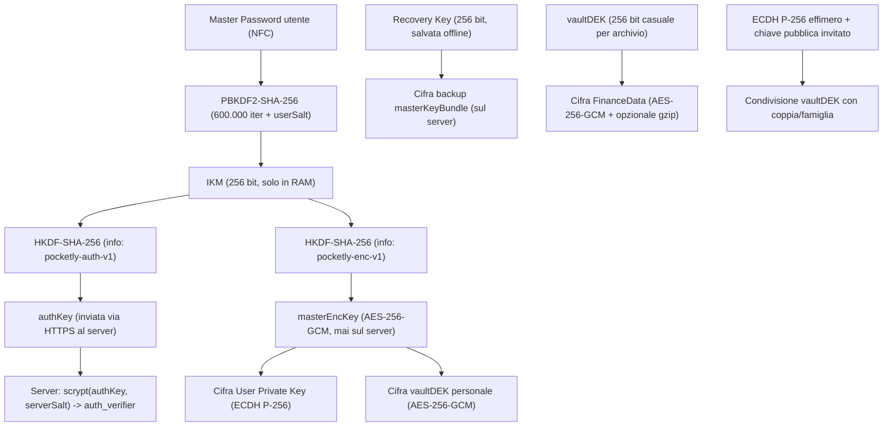
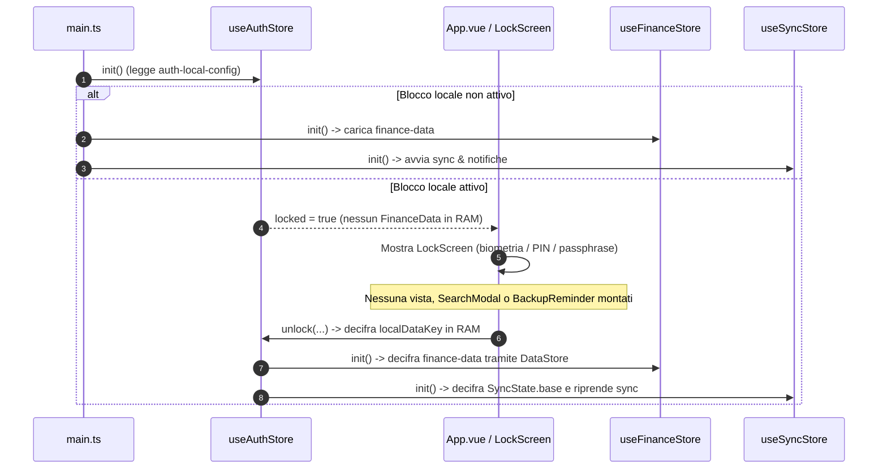

---
source-files:
  - src/main.ts
  - src/App.vue
  - src/router/index.ts
  - src/utils/settingsSections.ts
  - src/services/storage.ts
  - src/services/backupCrypto.ts
  - src/services/sync/api.ts
  - src/services/sync/engine.ts
  - src/services/notifications/api.ts
  - src/services/notifications/webpushCrypto.ts
  - src/stores/finance.ts
  - src/stores/sync.ts
  - src/stores/notifications.ts
  - src/components/SyncSettings.vue
  - src/components/LoadErrorScreen.vue
  - src/views/SettingsView.vue
  - server/main.py
  - server/webpush.py
  - deploy/proxmox/nginx/pocketly.conf
  - deploy/proxmox/pocketly-sync.service
verified: 2026-11-26
---

# Progetto e Piano Implementativo: Autenticazione (PKT-12)

Questo documento definisce l'architettura, il modello crittografico, i flussi applicativi, le API backend e il piano operativo per introdurre l'autenticazione in **Pocketly**, tracciata in [Backlog di Pocketly](../backlog.md) sotto **PKT-12** e implementata in **PKT-25**.

---

## 1. Obiettivi e Decisioni Architetturali

L'autenticazione di Pocketly rispetta integralmente i principi cardine dell'app (**privacy-first**, **offline-first**, **Zero-Knowledge**, backend Python 3.9+ senza dipendenze esterne, compatibilità con le 6 combinazioni piattaforma × tema) ed è progettata su **due livelli complementari e incrementali**:

| Asse | Stato attuale | Progetto target (PKT-12) |
|---|---|---|
| **Uso locale / offline** | Accesso immediato senza account | **Invariato:** uso puramente locale sempre consentito senza login né server (incluso deploy statico Vercel). |
| **Privacy sul dispositivo (Livello A)** | Nessun blocco; IndexedDB in chiaro | **Blocco locale opzionale:** Lock screen + auto-lock + privacy screen + **cifratura AES-256-GCM at-rest** di `'finance-data'` e `SyncState.base`, con sblocco rapido biometrico (WebAuthn PRF) o PIN / passphrase. |
| **Autenticazione server (Livello B)** | `POCKETLY_SYNC_KEY` statica unica | **Account su invito/admin** (self-hosted Proxmox) + **sessioni revocabili per dispositivo** (Refresh Token in cookie `HttpOnly` con rotazione + Access Token breve in RAM). |
| **Credenziali Zero-Knowledge** | Due segreti separati (`serverKey` + `password`) | **Master Password unica Zero-Knowledge** (`PBKDF2` → `HKDF` per `authKey` ⊥ `masterEncKey`) + **Envelope Encryption (`vaultDEK`)** + **Recovery Key**. |
| **Password Manager & Autofill** | Form sync con `serverKey` `autocomplete="off"` | **Piena compatibilità nativa** (Apple Passwords, Google Password Manager, Bitwarden, 1Password, KeePassXC, Proton Pass) su login, registrazione 2-step, cambio password e sblocco locale. |
| **Multi-utente e Famiglia** | Single-tenant (`current.json`, `push.json`) | **Multi-tenant SQLite WAL** (coordinato con [scalabilita.md](./scalabilita.md) §4.5) con archivi personali e **archivi condivisi coppia/famiglia** via key-wrapping **ECDH P-256**. |

---

## 2. Stato Attuale e Limiti Verificati sul Codice

Dall'analisi diretta del codice sorgente emergono cinque limiti strutturali che questa architettura risolve:

1. **Dati locali in chiaro in IndexedDB:** [`deviceDataStore`](../../src/services/storage.ts) salva `FinanceData` in chiaro sotto `DATA_KEY = 'finance-data'`. Anche [`useSyncStore`](../../src/stores/sync.ts) salva in chiaro nella chiave `'sync-config'` sia `serverKey` sia `state.base: FinanceData` (l'intera copia dell'ultima versione sincronizzata per il 3-way merge).
2. **Nessuna protezione di accesso sul dispositivo:** chiunque apra l'app su un telefono o PC sbloccato visualizza immediatamente saldi, spese e prestiti; inoltre lo switcher app di iOS/Android può catturare miniature con importi visibili.
3. **Chiave server statica e non revocabile per dispositivo:** [`server/main.py`](../../server/main.py) verifica un'unica `POCKETLY_SYNC_KEY` tramite `Authorization: Bearer` in `Handler.authorized` per tutti gli endpoint `/api/sync` e `/api/push/*`. Se un telefono viene smarrito, occorre ruotare `POCKETLY_SYNC_KEY` sul server e riconfigurare tutti gli altri dispositivi.
4. **Doppia credenziale poco ergonomica:** [`SyncSettings.vue`](../../src/components/SyncSettings.vue) richiede sia `serverKey` sia `password` di cifratura, ostacolando l'uso dei password manager.
5. **Single-tenant su file JSON:** [`Store`](../../server/main.py) (`current.json`, `history/v*.json`) e [`PushStore`](../../server/main.py) (`push.json`) non supportano utenti separati né archivi condivisi tra account distinti.

---

## 3. Modello Crittografico Zero-Knowledge (Envelope Encryption)

Tutta la crittografia lato client usa esclusivamente la **Web Crypto API** nativa del browser (estendendo i pattern già presenti in [`src/services/backupCrypto.ts`](../../src/services/backupCrypto.ts) e [`src/services/notifications/webpushCrypto.ts`](../../src/services/notifications/webpushCrypto.ts)), senza introdurre dipendenze esterne.

### 3.1 Derivazione delle chiavi e separazione dei domini
- **Normalizzazione input:** `username` normalizzato (`trim().toLowerCase()`, regex `^[a-z0-9._-]{3,32}$`); `masterPassword` normalizzata con `password.normalize('NFC')` (come in `deriveKey` di `backupCrypto.ts`, lunghezza minima consigliata 12 caratteri, pavimento rigido `MIN_PASSWORD_LENGTH = 8`).
- **Pre-login KDF params anti-enumerazione:** `POST /api/auth/params` accetta `{ "username": "..." }` e restituisce `{ "kdf": "PBKDF2-SHA256", "iterations": 600000, "salt": "<base64-16B>" }`. Se lo username non esiste, il server restituisce comunque un salt **sintetico deterministico** `HMAC-SHA256(server_pepper, normalized_username)[:16]`, impedendo di enumerare gli account esistenti.
- **Derivazione client:**
  1. `IKM = PBKDF2-SHA-256(masterPassword_NFC, userSalt, iterations)` → 256 bit importati come chiave `HKDF` in RAM.
  2. `authKey = HKDF-SHA-256(IKM, salt="", info="pocketly-auth-v1", len=256)` → inviata in base64 al server durante registrazione/login/cambio password. Il server calcola e memorizza esclusivamente `hashlib.scrypt(authKey, serverSalt, n=16384, r=8, p=1, dklen=32)` (disponibile nella stdlib Python 3.9+) confrontato con `hmac.compare_digest`.
  3. `masterEncKey = HKDF-SHA-256(IKM, salt="", info="pocketly-enc-v1", len=256)` → `CryptoKey` AES-256-GCM **non estraibile** (`extractable: false`). Non lascia mai il dispositivo.
- **Garanzia Zero-Knowledge:** nemmeno con l'accesso completo al database SQLite del server è possibile risalire a `authKey`, alla Master Password o a `masterEncKey`, né decifrare i dati finanziari.

### 3.2 Envelope Encryption (`vaultDEK`), Cambio Password e Recovery Key
- Ogni archivio (`vault_id`, UUID) dispone di una chiave dati casuale **`vaultDEK`** (AES-256-GCM 256 bit).
- I payload di sincronizzazione sono cifrati con `vaultDEK` in formato `EncryptedBackup` v2 (retrocompatibile in lettura con i backup v1 esportati manualmente, con `AAD = "pocketly-vault:<vaultId>:v2"` e supporto al campo opzionale `compression: 'gzip'` coordinato con [scalabilita.md](./scalabilita.md) §4.4).
- **Cambio Master Password senza ricifratura dello storico:** l'utente deriva una nuova coppia `(newAuthKey, newMasterEncKey)` con un nuovo `kdf_salt`, ri-cifra localmente solo la propria `encrypted_private_key` e i propri `wrapped_dek`, e invia l'aggiornamento atomico a `POST /api/auth/change-password`.
- **Recovery Key (recupero Zero-Knowledge senza SMTP):** alla registrazione il client genera una chiave casuale a 256 bit formattata in gruppi leggibili Base32 (es. `PKLY-XXXX-XXXX-...`), mostrata una sola volta con opzione copia/stampa. Da essa deriva una `recoveryWrapKey` che cifra un bundle `{ privateKey, personalVaultDEK }` salvato sul server in `users.encrypted_recovery_blob`. In caso di dimenticanza della Master Password, l'amministratore self-hosted emette un token di reset monouso (via pannello Admin o CLI); l'utente inserisce token + Recovery Key + nuova Master Password, il client decifra il bundle localmente, lo ri-cifra con la nuova `masterEncKey` e completa il ripristino su `POST /api/auth/recover`.

### 3.3 Archivi Condivisi Coppia/Famiglia (ECDH P-256)
- Alla creazione dell'account ogni utente genera una coppia asimmetrica **ECDH P-256** (chiave pubblica in chiaro in `users.public_key`, chiave privata PKCS#8 cifrata con `masterEncKey` e `AAD = "pocketly-privkey-v1:<userId>"` in `users.encrypted_private_key`).
- **Condivisione di un vault:**
  1. Il proprietario richiede la chiave pubblica dell'invitato (`GET /api/users/{username}/public-key`).
  2. La UI calcola e mostra un **codice di verifica breve (Safety Fingerprint)** ricavato da `SHA-256(publicKey)` (es. 4 blocchi esadecimali/numerici) verificabile di persona o via chat contro eventuali manomissioni del server.
  3. Il client genera una coppia ECDH P-256 effimera, deriva un segreto condiviso `ECDH(ephemeralPriv, inviteePub)` → `HKDF-SHA-256` (`info="pocketly-vault-share-v1:<vaultId>"`) → AES-256-GCM, cifra `vaultDEK` e invia `{ ephemeralPub, iv, wrappedDek }` a `POST /api/vaults/{vaultId}/invites`.
  4. L'invitato accetta l'invito: decifra `vaultDEK` con la propria chiave privata, lo ri-cifra sotto la propria `masterEncKey` e lo salva in `vault_members`. Da quel momento sincronizza lo stesso `vault_id` con le proprie credenziali e sessioni revocabili.
- **Rimozione membro e rotazione chiave:** rimuovendo un membro, il proprietario genera una nuova `vaultDEK` (`key_version + 1`), la ri-cifra verso le chiavi pubbliche dei soli membri rimanenti (in un'unica operazione atomica su `DELETE /api/vaults/{vaultId}/members/{userId}`) e invia il successivo snapshot cifrato con la nuova chiave, garantendo *forward secrecy*.

---

## 4. Livello A — Blocco Locale dell'App e Cifratura IndexedDB At-Rest

Il Livello A opera **interamente sul dispositivo (100% offline)**, senza dipendere dal server: funziona anche per chi usa Pocketly solo in locale o dalla build statica su Vercel.

### 4.1 Cifratura At-Rest di IndexedDB (`src/services/localVault.ts`, `src/services/storage.ts`)
- **Stato predefinito (zero attrito):** blocco disattivato; `deviceDataStore` legge/scrive `'finance-data'` esattamente come oggi.
- **Quando il blocco locale è attivo:**
  - Una chiave simmetrica locale `localDataKey` (AES-256-GCM 256 bit) vive **solo in RAM** dentro `useAuthStore` mentre l'app è sbloccata.
  - Su IndexedDB (chiave `'auth-local-config'`) vengono salvati esclusivamente i metadati di configurazione (timeout auto-lock, metodi abilitati) e i **wrapper cifrati** di `localDataKey`:
    1. **Wrapper primario (Passphrase locale o Master Password):** `PBKDF2-SHA-256` (600.000 iterazioni, salt casuale) + `AES-256-GCM`.
    2. **Wrapper biometrico opzionale (WebAuthn PRF):** credenziale locale creata via `navigator.credentials.create` con `authenticatorSelection: { authenticatorAttachment: 'platform', residentKey: 'preferred', userVerification: 'required' }` ed estensione `prf: { eval: { first: salt32 } }`. Non richiede backend (supportata su iOS/Safari 18+, Chrome Android/Desktop, macOS Touch ID, Windows Hello). L'output PRF a 32 byte derivato dall'hardware passa da HKDF-SHA-256 e sblocca `localDataKey` con Face ID / impronta. Prima di attivare l'opzione, l'app verifica `getClientExtensionResults()?.prf?.enabled === true` con fallback pulito se non supportato.
    3. **Wrapper PIN locale opzionale (6+ cifre):** `PBKDF2-SHA-256` (600.000 iterazioni) + contatore errori persistito in `'auth-local-config'`. Dopo **5 errori consecutivi**, il wrapper PIN viene distrutto e l'app richiede obbligatoriamente la Passphrase/Master Password. La UI chiarisce esplicitamente che il PIN protegge da accessi casuali al telefono, mentre Biometria/Passphrase garantisce protezione crittografica piena anche contro estrazione fisica del profilo browser.
  - **Dati cifrati su disco (incluso `SyncState.base`):**
    - `'finance-data'` (gestito da `deviceDataStore` in [`src/services/storage.ts`](../../src/services/storage.ts)) viene salvato come envelope `EncryptedLocalRecord { format: 'pocketly-local-encrypted', version: 1, iv, data }` con `AAD = "pocketly-local-v1:finance-data"`.
    - In `'sync-config'` ([`src/stores/sync.ts`](../../src/stores/sync.ts)), **`SyncState.base`** viene cifrata con la stessa `localDataKey` (`AAD = "pocketly-local-v1:sync-base"`), chiudendo la falla che lascerebbe altrimenti una copia completa di `FinanceData` leggibile in chiaro in IndexedDB.
    - Preferenze di avvio (`localStorage`: `'locale'`, `'appearance-platform'`, `'appearance-theme'`) e metadati non finanziari (`'backup-meta'`, `'notification-config'`) restano in chiaro per consentire il primo render senza lampi di tema e la diagnostica.
    - **`LoadErrorScreen` preservata:** se il record locale cifrato è corrotto, `readStoredDataRaw()` consente comunque di scaricare il blob grezzo senza mai sovrascriverlo.

### 4.2 Ciclo di Vita Avvio, Auto-Lock e Notifiche Discrete

- **Auto-lock:** configurabile in Impostazioni → Sicurezza (`/impostazioni/sicurezza`, integrata in [`src/utils/settingsSections.ts`](../../src/utils/settingsSections.ts)): *Immediato* (al passaggio in background), *1 min*, *5 min* (predefinito), *15 min*, oppure *Solo manuale*, più azione rapida «Blocca ora».
- **Azzeramento RAM su `lock()`:** rimuove `localDataKey` e `accessToken` dalla memoria, resetta `useFinanceStore` (`ready = false`, `data = createEmptyData()`), ferma il polling in `useSyncStore` e chiude modali/Omnisearch.
- **Privacy Screen nello switcher app:** al passaggio su `document.visibilityState === 'hidden'` (quando il blocco è attivo), `App.vue` rende un overlay opaco con il solo marchio Pocketly per impedire anteprime sensibili nello switcher di iOS/Android.
- **Notifiche discrete:** opzione booleana in `NotificationConfig` («Nascondi importi e descrizioni nelle notifiche») che fa generare a [`useNotificationsStore`](../../src/stores/notifications.ts) testi generici ("Hai una scadenza in Pocketly") sia per i promemoria locali sia per i payload cifrati inviati al server push.

### 4.3 Compatibilità Nativa con Password Manager e Autofill
Il modello a **Master Password unica** rende Pocketly compatibile con Apple Passwords / iCloud Keychain, Google Password Manager, Bitwarden, 1Password, KeePassXC e Proton Pass. Tutti i moduli di autenticazione devono rispettare questi contratti HTML:

1. **Form di Login:**
   - `<form method="post" @submit.prevent="onLogin">` con `<button type="submit">` esplicito.
   - `<input type="text" name="username" autocomplete="username" autocapitalize="none" autocorrect="off" spellcheck="false" />`
   - `<input type="password" name="password" autocomplete="current-password" />`
   - Navigazione SPA reale (cambio route / smontaggio form) al successo, così tutti i password manager rilevano l'invio e propongono *Salva password*.
2. **Form di Registrazione con invito in 2 step:**
   - **Step 1 (Verifica invito):** solo campo codice invito `type="text" autocomplete="one-time-code"` (mai `type="password"`, così i password manager non lo confondono con la password).
   - **Step 2 (Credenziali account):** `<form>` pulito con soli `autocomplete="username"` e `autocomplete="new-password"` (+ conferma `autocomplete="new-password"` e attributo `passwordrules` per Safari/iOS Passwords).
3. **Cambio Master Password:**
   - Include `autocomplete="username"` (`readonly`), `autocomplete="current-password"` (attuale) e `autocomplete="new-password"` (nuova + conferma) per innescare automaticamente *"Aggiorna password salvata"*.
4. **Schermata di sblocco (`LockScreen.vue`):**
   - **Sblocco con Master Password / passphrase:** `<form>` contenente `<input type="text" name="username" autocomplete="username" :value="auth.username || 'pocketly-local'" readonly class="sr-only" tabindex="-1" aria-hidden="true" />` (mai `display: none`) + `<input type="password" name="password" autocomplete="current-password" />`, abilitando l'autofill 1-tap anche allo sblocco.
   - **Campo PIN locale (6 cifre):** marcato esplicitamente come **non-password** (`type="text" inputmode="numeric" autocomplete="off"`, mascheramento CSS `-webkit-text-security: disc`, attributi `data-1p-ignore`, `data-bwignore="true"`, `data-lpignore="true"`) per evitare che il password manager sovrascriva per errore la Master Password con il PIN.
5. **Nota WebAuthn PRF e hostname Proxmox:** i password manager funzionano in HTTPS sia su IP sia su hostname, ma **la specifica WebAuthn vieta indirizzi IP nudi come `rpId`**. Per usare lo sblocco biometrico WebAuthn PRF in rete domestica su Proxmox occorre servire Pocketly con un hostname stabile (es. dominio proprio o DNS locale).

---

## 5. Livello B — Account, Sessioni Revocabili e Backend Multi-Tenant

### 5.1 Sessioni Revocabili: Cookie `HttpOnly` con Rotazione + Access Token in RAM
In sostituzione della chiave statica `serverKey` salvata in IndexedDB:
- **Refresh Token opaco (256 bit casuali):** emesso dal server in un cookie `HttpOnly; Secure; SameSite=Strict; Path=/api/auth` (durata 30 giorni sliding). Sul server è memorizzato solo `SHA-256(refreshToken)` nella tabella `sessions`.
  - **Rotazione e rilevamento furto:** ogni chiamata a `POST /api/auth/refresh` invalida il vecchio refresh token e ne emette uno nuovo nella stessa `token_family`. Se un refresh token già speso viene ripresentato, il server revoca l'intera `token_family` (protezione contro clonazione del cookie).
  - **Protezione CSRF su `/api/auth/refresh` e `/api/auth/logout`:** oltre a `SameSite=Strict`, il server verifica la presenza dell'header personalizzato `X-Pocketly-Client: 1` e la corrispondenza dell'header `Origin` con `Host`.
- **Access Token breve (15 minuti):** tenuto esclusivamente in **RAM** (`useAuthStore`), inviato come `Authorization: Bearer <accessToken>` verso `/api/vaults/*`, `/api/sessions/*`, `/api/admin/*`. Firmato con `HMAC-SHA256` (`POCKETLY_TOKEN_SECRET`), con verifica di una cache in memoria delle sessioni revocate così che **`DELETE /api/sessions/{id}` revochi immediatamente un telefono perso o rubato** senza attendere la scadenza dei 15 minuti.
- **Compatibilità offline-first:** offline l'app lavora normalmente sui dati locali senza chiamare `/api/auth/refresh`; al ritorno della rete rinnova l'Access Token in modo trasparente tramite il cookie `HttpOnly` e riprende la sincronizzazione e la pianificazione Web Push.

### 5.2 Schema SQLite WAL (Unificato con `scalabilita.md` §4.5)
Un singolo database `POCKETLY_DATA_DIR/pocketly.db` gestito con `sqlite3` della libreria standard Python (`PRAGMA journal_mode=WAL; PRAGMA foreign_keys=ON; PRAGMA busy_timeout=5000;`):

| Tabella | Colonne principali e chiavi | Ruolo |
|---|---|---|
| `users` | `id PK`, `username UNIQUE`, `role` (`admin`/`member`), `kdf_salt`, `kdf_iterations`, `auth_verifier`, `public_key`, `encrypted_private_key`, `encrypted_recovery_blob`, `created_at`, `disabled_at` | Identità account e blob crittografici Zero-Knowledge |
| `invites` | `id PK`, `code_hash UNIQUE`, `created_by`, `role`, `expires_at`, `used_by`, `used_at`, `revoked_at` | Inviti monouso con scadenza generati da admin/CLI |
| `password_resets` | `id PK`, `user_id`, `token_hash UNIQUE`, `created_by`, `expires_at`, `used_at` | Token di reset emessi da admin per il recupero tramite Recovery Key |
| `sessions` | `id PK`, `user_id`, `device_id`, `device_name`, `refresh_hash UNIQUE`, `token_family`, `created_at`, `last_seen_at`, `expires_at`, `revoked_at` | Sessioni attive per dispositivo e revoca immediata |
| `vaults` | `id PK`, `kind` (`personal`/`shared`), `name`, `key_version`, `created_by`, `created_at` | Archivi finanziari personali e condivisi |
| `vault_members` | `(vault_id, user_id) PK`, `role` (`owner`/`editor`), `wrapped_dek`, `key_version`, `added_at` | Appartenenza e `vaultDEK` cifrata per singolo membro |
| `vault_invites` | `id PK`, `vault_id`, `invited_user_id`, `invited_by`, `ephemeral_pub`, `wrapped_dek`, `key_version`, `status`, `created_at` | Inviti pendenti per archivi condivisi (ECDH P-256) |
| `sync_state` | `vault_id PK`, `version`, `updated_at`, `payload_json` | Stato cifrato corrente per archivio (`vault_id` = `tenant_id` di `scalabilita.md` §4.5) |
| `sync_history` | `(vault_id, version) PK`, `payload_json` | Ultime `HISTORY_KEEP = 30` versioni cifrate per archivio |
| `push_meta` | `key PK`, `value_json` | Coppia chiavi VAPID del server |
| `push_devices` | `(vault_id, device_id) PK`, `user_id`, `endpoint`, `p256dh`, `auth`, `updated_at` | Sottoscrizioni Web Push isolate per archivio e utente |
| `push_schedule` | `(vault_id, id, device_id) PK`, `fire_at`, `payload` + indice su `fire_at` | Promemoria cifrati `aes128gcm` con query indicizzata |
| `push_sent` | `(vault_id, item_key) PK`, `sent_at` | Deduplicazione invii push (retention 30 giorni) |

### 5.3 Specifica Endpoint API REST (v2)

| Metodo | Endpoint | Auth | Descrizione |
|---|---|---|---|
| `GET` | `/api/health` | Pubblico | `{"service": "pocketly-sync", "api": 2, "authMode": "accounts" \| "legacy"}` |
| `POST` | `/api/auth/params` | Pubblico | Parametri KDF (`kdf`, `iterations`, `salt`) anti-enumerazione per `username` |
| `POST` | `/api/auth/register` | Codice invito | Crea utente, vault personale, chiavi cifrate e prima sessione (`Set-Cookie`) |
| `POST` | `/api/auth/login` | Credenziali | Verifica `authKey` (`scrypt`), emette `accessToken` + cookie `HttpOnly`, restituisce chiavi cifrate e vault |
| `POST` | `/api/auth/refresh` | Cookie + CSRF header | Ruota refresh token (rileva reuse) e restituisce nuovo `accessToken` |
| `POST` | `/api/auth/logout` | Cookie / Bearer | Revoca sessione corrente e cancella cookie |
| `POST` | `/api/auth/change-password` | Bearer | Aggiorna atomicamente `kdf_salt`, `auth_verifier`, `encrypted_private_key`, `wrapped_dek`; revoca opzionale altre sessioni |
| `POST` | `/api/auth/recover` | Token reset admin | Ripristina accesso con nuove chiavi derivate client-side dalla Recovery Key |
| `GET` | `/api/sessions` | Bearer | Elenco dispositivi collegati (`id`, `deviceName`, `lastSeenAt`, `current`) |
| `DELETE` | `/api/sessions/{id}` | Bearer | Revoca immediata sessione e rimozione sottoscrizioni push di quel `device_id` |
| `GET` / `POST` | `/api/admin/invites` | Bearer (`admin`) | Lista e creazione inviti monouso con scadenza (anche via CLI) |
| `POST` | `/api/admin/password-resets` | Bearer (`admin`) | Emissione token di reset monouso per utente con Recovery Key |
| `GET` / `POST` | `/api/vaults` | Bearer | Lista vault accessibili e creazione nuovo vault condiviso |
| `GET` | `/api/users/{username}/public-key` | Bearer | Chiave pubblica ECDH P-256 per invito a vault condiviso |
| `POST` | `/api/vaults/{vaultId}/invites` | Bearer (`owner`) | Invito con `wrapped_dek` cifrato ECDH P-256 |
| `POST` | `/api/vaults/{vaultId}/invites/{id}/accept` | Bearer | Accettazione invito con `wrapped_dek` ri-cifrato sotto `masterEncKey` |
| `DELETE` | `/api/vaults/{vaultId}/members/{userId}` | Bearer (`owner`) | Rimozione membro + aggiornamento atomico `wrapped_dek` (`key_version + 1`) |
| `GET` / `PUT` | `/api/vaults/{vaultId}/sync` | Bearer (membro) | Sync cifrata E2E con `ETag`/`If-None-Match` e `409 Conflict` |
| `*` | `/api/vaults/{vaultId}/push/*` | Bearer (membro) | `config`, `subscription` (`PUT`/`DELETE`), `schedule` (`PUT`), `test` (`POST`) |

### 5.4 Multi-Vault sul Frontend
- Se l'utente partecipa a un solo vault (personale), la UI non mostra alcun selettore aggiuntivo (zero complessità per l'utente singolo).
- Se l'utente partecipa a più vault (es. *Personale* + *Casa/Famiglia*), un selettore compatto consente di cambiare archivio attivo.
- In IndexedDB le chiavi vengono namespaced per archivio (`finance-data:<vaultId>`, `sync-config:<vaultId>`), mantenendo `'finance-data'` come chiave di default/migrazione trasparente per l'archivio locale preesistente.

---

## 6. Migrazione da `POCKETLY_SYNC_KEY`, Deploy Proxmox e Sicurezza

### 6.1 Onboarding Admin e Transizione Zero-Data-Loss
1. **Bootstrap su Proxmox:** comando CLI `python3 server/main.py --create-invite --admin` (o modulo dedicato `server/cli.py`) che stampa un codice invito admin monouso valido 1 ora.
2. **Modalità transitoria (`legacy` → `accounts`):**
   - Finché `pocketly.db` non contiene utenti e `POCKETLY_SYNC_KEY` è configurata, il server risponde `authMode: "legacy"` mantenendo operativi `/api/sync` e `/api/push/*`.
   - Alla creazione del primo account admin, il dispositivo già sincronizzato (o un import da `current.json` + vecchia password) ricifra i dati sotto la nuova `vaultDEK` del vault iniziale; i file legacy `current.json`, `push.json` e `history/v*.json` vengono archiviati (`.migrated` / `history-legacy/`) senza mai essere cancellati, restando apribili con «Importa backup».
   - Completata la migrazione, gli endpoint legacy rispondono `410 Gone` guidando i dispositivi ancora vecchi al login account.

### 6.2 Hardening, Rate Limiting e Coordinamento con `PKT-14` / `PKT-18`
- **Rate limiting a doppio asse:** estendere `Failures` in [`server/main.py`](../../server/main.py) con contatori separati per IP (`X-Real-IP`, fidato solo su loopback `127.0.0.1`) e per `username` su `/api/auth/login`, `/api/auth/register`, `/api/auth/recover`, integrando il pruning automatico della mappa in memoria già specificato in [scalabilita.md](./scalabilita.md) §4.1.
- **Nginx (`deploy/proxmox/nginx/pocketly.conf`):** preservare `Set-Cookie`, `Host` e `Origin` nel blocco `location /api/`; aggiungere header di sicurezza (`Strict-Transport-Security`, `X-Content-Type-Options: nosniff`, `Referrer-Policy: no-referrer`, `Content-Security-Policy` base) in coordinamento con l'audit **PKT-14**.
- **Privacy nei log:** `Handler.log_message` non deve mai registrare username, token, cookie, codici invito o payload.
- **Zero-downtime SQLite:** la migrazione dello storage server in SQLite WAL della Fase B1 realizza contemporaneamente la **Fase 3 di [scalabilita.md](./scalabilita.md)** (`PKT-18`), evitando di scrivere due backend diversi.

---

## 7. Piano Implementativo a 3 Fasi (Guida Operativa per PKT-25)

L'implementazione è tracciata nel backlog in **PKT-25** (attività ombrello) ed è scomposta in **9 sotto-task operativi sequenziali** (`PKT-25.1`–`PKT-25.9`) raggruppati nelle tre fasi indipendenti:

| Sotto-task | Fase | Ambito | Dipendenze | Coordinamento |
|---|---|---|---|---|
| **PKT-25.1** | A | `authCrypto.ts`, `localVault.ts`, cifratura IndexedDB at-rest (`'finance-data'` e `SyncState.base`), `finance.init()` idempotente / `resetForLock()` | — | `PKT-14` punto 3; `PKT-27` §4.2–4.3 |
| **PKT-25.2** | A | `useAuthStore`, boot condizionato (`main.ts`, `App.vue`), auto-lock, `LockScreen.vue` e privacy screen | `PKT-25.1` | Contratti password manager (§4.3) |
| **PKT-25.3** | A | `/impostazioni/sicurezza` (`SettingsSecuritySection.vue`) e notifiche discrete | `PKT-25.2` | Chiude e rende rilasciabile la **Fase A** |
| **PKT-25.4** | B1 | Storage backend SQLite WAL multi-tenant (`server/db.py`) e migrazione zero-data-loss da JSON legacy | — | Realizza `PKT-18` Fase 3; `PKT-27` §4.7 |
| **PKT-25.5** | B1 | `server/auth.py`, sessioni `HttpOnly` revocabili, API REST v2, rate limiting IP+username e CLI admin | `PKT-25.4` | `PKT-18` §4.1; dual-mode `legacy` → `accounts` |
| **PKT-25.6** | B1 | Envelope Encryption client (`vaultDEK`, Recovery Key), policy robustezza Master Password e client API auth/sync/push | `PKT-25.1`, `PKT-25.5` | `PKT-14` punto 4; `PKT-18` §4.4; `PKT-27` §4.2 |
| **PKT-25.7** | B1 | UI Account (login, registrazione 2-step, Recovery Key, cambio password, dispositivi, admin), migrazione guidata legacy e deploy Proxmox | `PKT-25.3`, `PKT-25.6` | `PKT-14` punto 4 + header Nginx; chiude la **Fase B1** |
| **PKT-25.8** | B2 | Crittografia condivisione ECDH P-256, Safety Fingerprint e API membri/inviti con rotazione `key_version + 1` | `PKT-25.7` | *Forward secrecy* su rimozione membro |
| **PKT-25.9** | B2 | Storage IndexedDB namespaced per `vaultId`, selettore archivio (solo con ≥ 2 vault) e UI condivisione famiglia | `PKT-25.8` | Chiude la **Fase B2** e `PKT-25` |

### Fase A — Blocco Locale dell'App e Cifratura IndexedDB At-Rest (Solo Frontend)
*Zero impatti sul server; rilasciabile subito, funziona offline e su Vercel. Risolve il punto 3 di `PKT-14` (`PKT-25.1` → `PKT-25.3`).*
- **`PKT-25.1` (Crypto & IndexedDB at-rest):**
  - `src/services/authCrypto.ts`: helper Web Crypto (`PBKDF2`, `HKDF` separazione domini, wrap/unwrap AES-256-GCM, WebAuthn PRF).
  - `src/services/localVault.ts`: cifratura/decifratura at-rest di `EncryptedLocalRecord` (`'finance-data'` e `SyncState.base`).
  - Aggiornamento `src/services/storage.ts` (integrazione opzionale `localVault` dentro `deviceDataStore`, preservando `readStoredDataRaw`), `src/stores/sync.ts` (cifratura `SyncState.base`) e `src/stores/finance.ts` (`init()` idempotente + `resetForLock()`).
  - Test: `authCrypto.test.ts`, `localVault.test.ts`, test storage/corruzione e idempotenza `finance.ts`.
- **`PKT-25.2` (Store auth, boot, auto-lock e `LockScreen`):**
  - `src/stores/auth.ts`: stato `locked`, `localLockEnabled`, `unlock()`, `lock()`, auto-lock timer e gestione wrapper (passphrase / WebAuthn PRF / PIN con limite 5 tentativi).
  - `src/components/LockScreen.vue`: schermata di sblocco accessibile (6 combinazioni piattaforma × tema, contratti HTML password manager, campo PIN isolato) + privacy overlay.
  - Aggiornamento `src/main.ts` e `src/App.vue` (boot condizionato a `auth.locked` + privacy screen), `src/i18n/it.ts` e `src/i18n/en.ts`.
  - Test: `stores/auth.test.ts` (lock/unlock, limite tentativi PIN, auto-lock, azzeramento RAM).
- **`PKT-25.3` (Impostazioni Sicurezza e notifiche discrete):**
  - `src/components/settings/SettingsSecuritySection.vue`: pannello Impostazioni → Sicurezza (`/impostazioni/sicurezza`) registrato in `src/utils/settingsSections.ts`, `src/router/index.ts`, `src/views/SettingsView.vue` e `src/components/settings/SettingsIndex.vue`.
  - Aggiornamento `src/stores/notifications.ts`, `src/domain/notifications.ts` e `src/components/NotificationSettings.vue` per l'opzione notifiche discrete (`discreet`).

### Fase B1 — Account Zero-Knowledge, Sessioni Revocabili e Backend SQLite Multi-Utente
*Coordina e realizza anche la Fase 3 di `PKT-18` ([scalabilita.md](./scalabilita.md) §4.5) e assorbe il punto 4 di `PKT-14` (sincronizzazione solo con account registrato + policy robustezza Master Password; `PKT-25.4` → `PKT-25.7`).*
- **`PKT-25.4` (Backend SQLite WAL e migrazione legacy):**
  - `server/db.py`: schema SQLite WAL (`users`, `invites`, `password_resets`, `sessions`, `vaults`, `vault_members`, `vault_invites`, `sync_state`, `sync_history`, `push_*`), migrazione zero-data-loss da JSON legacy.
- **`PKT-25.5` (Motore auth backend, API v2 e CLI admin):**
  - `server/auth.py`: `scrypt`, salt sintetico anti-enumerazione, HMAC access token + cache revoca immediata, cookie `HttpOnly` refresh rotation + detection reuse, rate limiting per IP + username.
  - `server/main.py` e `server/cli.py`: nuovi endpoint `/api/auth/*`, `/api/sessions/*`, `/api/admin/*`, `/api/vaults/{vaultId}/sync`, `/api/vaults/{vaultId}/push/*`, modalità dual-mode `legacy`/`accounts` (`410 Gone` a migrazione completata) e CLI bootstrap admin/inviti.
  - `server/test_main.py` (e test dedicati auth/db): copertura completa di login, anti-enumerazione, refresh rotation + reuse revocation, revoca immediata sessione, isolamento tra vault, migrazione legacy.
- **`PKT-25.6` (Envelope Encryption client e API layer):**
  - Estensione `src/services/authCrypto.ts` e `src/services/backupCrypto.ts` (`authKey` ⊥ `masterEncKey`, `vaultDEK` v2, Recovery Key, policy lunghezza minima e robustezza Master Password).
  - `src/services/auth/api.ts`: client REST per `/api/auth/*`, `/api/sessions/*`, `/api/admin/*`, `/api/vaults/*` (con `credentials: 'same-origin'` e header `X-Pocketly-Client: 1`).
  - `src/services/sync/api.ts`, `src/services/sync/engine.ts`, `src/services/notifications/api.ts`, `src/stores/auth.ts`, `src/stores/sync.ts`, `src/stores/notifications.ts`: supporto `/api/vaults/{vaultId}/*` e refresh automatico su `401` con Access Token in RAM.
- **`PKT-25.7` (UI Account e Deploy Proxmox):**
  - UI Account/Login/Registrazione 2-step (piena compatibilità password manager), Recovery Key, Cambio Master Password, Gestione Dispositivi collegati, migrazione guidata legacy e pannello Inviti Admin dentro `/impostazioni/sicurezza` e `SyncSettings.vue`.
  - Deploy (`deploy/proxmox/`): aggiornamento `install-sync.sh`, `pocketly-sync.service`, `nginx/pocketly.conf` e documentazione `deploy.md`.

### Fase B2 — Archivi Condivisi Coppia/Famiglia (Zero-Knowledge ECDH P-256)
*Dipende dalla Fase B1 (`PKT-25.8` → `PKT-25.9`).*
- **`PKT-25.8` (Crittografia ECDH P-256 & API backend):** key-wrapping ECDH P-256 della `vaultDEK`, calcolo **Safety Fingerprint**, endpoint `/api/users/{username}/public-key`, `/api/vaults/{vaultId}/invites/*`, `DELETE /api/vaults/{vaultId}/members/{userId}` con rotazione `key_version + 1` e test end-to-end ECDH + *forward secrecy*.
- **`PKT-25.9` (Storage Multi-Vault & UI famiglia):** chiavi IndexedDB namespaced per `vaultId`, isolamento sync/push multi-vault, creazione archivio condiviso, flusso invito con verifica Safety Fingerprint, accettazione invito, rimozione membro e selettore archivio attivo (visibile solo con ≥ 2 vault).

### Checklist di Verifica Finale per l'Implementazione (PKT-25)
- `npm run test`, `npm run typecheck`, `npm run test:server`, `npm run build`, `npm run docs:check` tutti verdi.
- Verifica manuale password manager (salvataggio, autofill, aggiornamento) su Safari/iOS Passwords, Chrome/Google Password Manager e almeno un gestore esterno (es. Bitwarden/1Password), accertandosi che il campo PIN non sovrascriva mai la Master Password.
- Verifica visiva di `LockScreen`, modali login/registrazione e `/impostazioni/sicurezza` su tutte le **6 combinazioni piattaforma × tema** (`ios` / `android` / `desktop` × `light` / `dark`) usando esclusivamente i gettoni semantici di `src/style.css`.
- Aggiornamento contestuale di `docs/riferimento/mappa-codice.md`, `docs/architettura/dati-e-sincronizzazione.md`, `docs/architettura/backend.md`, `docs/architettura/deploy.md`, `docs/architettura/frontend.md` e `docs/guide/test-utente.md`.
