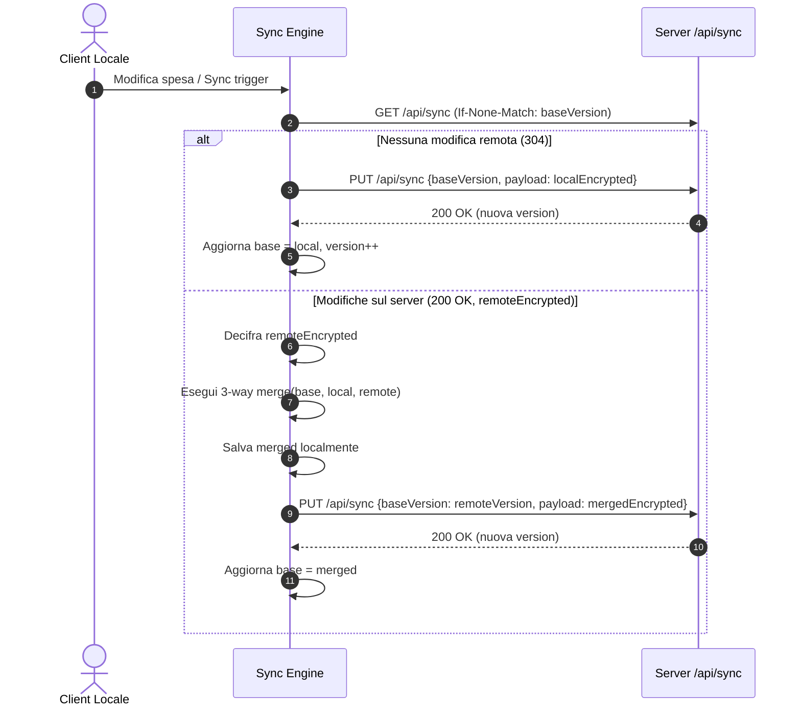

---
source-files:
  - src/types/models.ts
  - src/domain/merge.ts
  - src/domain/savings.ts
  - src/services/storage.ts
  - src/services/backupCrypto.ts
  - src/services/sync/api.ts
  - src/services/sync/engine.ts
  - src/services/csvExport.ts
  - src/services/exportData.ts
  - src/services/xlsx/writer.ts
  - src/services/xlsx/zipWriter.ts
  - src/stores/finance.ts
  - src/stores/sync.ts
verified: 2026-11-12
---

# Architettura Dati e Sincronizzazione

Questo documento descrive in dettaglio la modellazione dei dati, la persistenza locale, il protocollo di sincronizzazione e l'algoritmo di merge a 3 vie di Pocketly.

---

## 1. Modello Dati e Persistenza Locale

Tutti i dati dell'applicazione sono raggruppati nell'interfaccia [`FinanceData`](../../src/types/models.ts) (schema v2):

- `schemaVersion`: numero intero di versione schema (attualmente `2`).
- `categories`: lista di entità `Tag { id, name, color }`.
- `paymentMethods`: lista di entità `Tag { id, name, color }`.
- `tags`: lista di entità `Tag { id, name, color }`.
- `oneTimeExpenses`: lista di [`OneTimeExpense`](../../src/types/models.ts).
- `recurringExpenses`: lista di [`RecurringExpense`](../../src/types/models.ts).
- `incomes`: lista di [`Income`](../../src/types/models.ts).
- `loans`: lista di [`Loan`](../../src/types/models.ts) con i rispettivi [`Repayment`](../../src/types/models.ts).
- `simulations`: lista di [`Simulation`](../../src/types/models.ts).
- `forecast`: configurazione [`ForecastSettings`](../../src/types/models.ts).
- `budget`: impostazioni limiti [`BudgetSettings`](../../src/types/models.ts).
- `savingsGoals`: lista di [`SavingsGoal`](../../src/types/models.ts) per salvadanai e pianificazione obiettivi.

### Persistenza IndexedDB
La persistenza avviene tramite il modulo [`src/services/storage.ts`](../../src/services/storage.ts):
- L'interfaccia `DataStore` espone `load()` e `save(data: FinanceData)`.
- L'implementazione predefinita `deviceDataStore` salva l'intero oggetto JSON in IndexedDB sotto la chiave `'finance-data'` (costante `DATA_KEY`) tramite la libreria `idb-keyval`. Se la chiave è vuota, `load()` prova a recuperare i dati del vecchio prototipo da `localStorage` (`LEGACY_LOCALSTORAGE_KEYS`).
- Gli store per preferenze locali del dispositivo utilizzano chiavi separate su `idb-keyval`: `'sync-config'` (`stores/sync.ts`), `'notification-config'` e `'notifications-shown'` (`stores/notifications.ts`), `'backup-meta'` (`stores/backup.ts`). In questo modo la configurazione del dispositivo non si confonde con i dati finanziari condivisi.

---

## 2. Crittografia Zero-Knowledge

La sincronizzazione di Pocketly è **Zero-Knowledge**: il server non ha modo di conoscere il contenuto del database finanziario.

1. **Derivazione della chiave:**
   A partire dalla password di cifratura immessa dall'utente (almeno 8 caratteri, `MIN_PASSWORD_LENGTH`), il client deriva con PBKDF2-SHA-256 (600.000 iterazioni) una `CryptoKey` AES-GCM non estraibile (`deriveBackupKey` in `src/services/backupCrypto.ts`); la password non viene salvata. La chiave di accesso al server (almeno 32 caratteri) è un'altra cosa: serve solo come `Authorization: Bearer` e non cifra nulla.
2. **Cifratura del payload:**
   Ogni pacchetto inviato al server ha la struttura `EncryptedBackup` definita in `src/services/backupCrypto.ts`:
   ```ts
   export interface EncryptedBackup {
     format: 'pocketly-encrypted-backup'
     version: 1
     kdf: 'PBKDF2-SHA256'
     iterations: number // Predefinito 600.000 (accettati 100.000..5.000.000)
     salt: string       // Base64 (16 byte casuali)
     iv: string         // Base64 (12 byte casuali AES-GCM)
     data: string       // Payload cifrato in base64 con tag di autenticazione in coda
   }
   ```
   Il payload JSON di `FinanceData` viene codificato in UTF-8 e cifrato con AES-GCM 256-bit usando un IV (vettore di inizializzazione) casuale generato per ciascuna trasmissione e Additional Authenticated Data (`AAD = "pocketly-encrypted-backup:1"`).

---

## 3. Protocollo di Sincronizzazione

Il client comunica con il backend tramite due endpoint REST sotto `/api/sync`:
- `GET /api/sync`: restituisce il payload cifrato attuale e l'header HTTP `ETag` contenente la versione (`version: number`). Supporta `If-None-Match` restituendo `304 Not Modified` se il server non è cambiato.
- `PUT /api/sync`: invia il nuovo payload cifrato inviando nel corpo JSON `{"baseVersion": n, "payload": {...}}`. Se nel frattempo un altro client ha scritto sul server (versione remota > baseVersion), il server rifiuta la richiesta con `409 Conflict`.

### Fasi della Sincronizzazione (`src/services/sync/engine.ts`)



Se la scrittura fallisce con un conflitto (perché un altro dispositivo ha scritto nello stesso istante), l'engine ripete il ciclo di pull, merge e push fino a un massimo di 3 tentativi (`MAX_ATTEMPTS = 3`).

### Protezione Versioni Più Recenti (`NewerFormatError`)
Se i dati presenti sul server o in un file di backup importato presentano uno `schemaVersion` superiore a quello compreso dall'app in uso (`CURRENT_SCHEMA_VERSION`), il parser in [`src/services/migration.ts`](../../src/services/migration.ts) solleva l'eccezione `NewerFormatError`. Lo store `sync.ts` riconosce l'errore impostando lo stato di problema `outdated`. Il dispositivo rifiuta di toccare o salvare tali dati per evitare perdite accidentali di campi introdotti da release successive dell'applicazione.

---

## 4. Algoritmo di Merge a Tre Vie (`src/domain/merge.ts`)

L'algoritmo di unione implementato in [`merge.ts`](../../src/domain/merge.ts) è una funzione pura e deterministica che opera su tre elementi:
1. `base`: lo snapshot dei dati all'ultima sincronizzazione riuscita.
2. `local`: lo stato attuale sul dispositivo locale.
3. `remote`: lo stato attuale ricevuto dal server.

### Regole di Risoluzione:
- **Nessuna modifica:** se `local === base` e `remote === base`, il valore resta invariato.
- **Modifica da un solo lato:**
  - Se `local !== base` e `remote === base`, viene adottata la versione locale.
  - Se `remote !== base` e `local === base`, viene adottata la versione remota.
- **Modifica concorrente:**
  - Se sia `local` che `remote` differiscono da `base`:
    - Per campi scalari o impostazioni atomiche (`forecast`, `budget`), vince il valore locale del dispositivo che sta effettuando la sincronizzazione (`conflict(local, remote) => local`).
    - Per elenchi di entità identificate da `id` (`mergeIdList` per spese, entrate, categorie, prestiti):
      - Ciascuna entità con lo stesso `id` viene confrontata individualmente.
      - Se un elemento è stato cancellato localmente (presente in `base`, assente in `local`) e non è stato toccato da `remote`, l'elemento viene definitivamente eliminato.
      - Se un elemento è stato cancellato da una parte ma modificato dall'altra, **vince la modifica**, preservando il dato per evitare perdite accidentali.
      - Se un elemento è stato modificato in entrambi i dispositivi, vince la versione locale.
      - Gli elementi nuovi creati indipendentemente su entrambi i dispositivi vengono uniti mantenendo l'ordine del server seguito dai nuovi locali.

### Perché i Tombstone non sono necessari?
Nei sistemi di sincronizzazione a due vie, per distinguere un elemento "cancellato" da uno "ancora da ricevere" è necessario memorizzare un record fantasma (tombstone). In Pocketly il client memorizza sempre l'ultima **base** sincronizzata. Questo rende la tripla `(base, local, remote)` sufficiente per dedurre con certezza matematica se un'assenza è frutto di una cancellazione o di una mancata creazione, rendendo superflui i tombstone sia nel client che nel server.

---

## 5. Esportazione Tabellare (Excel .xlsx con Fogli Separati e CSV)

Il servizio [`src/services/exportData.ts`](../../src/services/exportData.ts) organizza i dati esportati esattamente come l'applicazione:
- **Spese variabili**: elenco delle uscite con date, importi, categorie, metodi, tag e note.
- **Spese ricorrenti**: elenco delle ricorrenze con frequenza, data inizio, data fine, categoria, metodo e promemoria.
- **Entrate**: elenco delle entrate con data, importo, categoria, metodo, tag e note.
- **Prestiti**: elenco dei prestiti concessi/ricevuti, importo, data, rimborsato, residuo e storico rimborsi.
- **Categorie e metodi**: elenco delle entità ausiliarie con relativi colori.

La generazione delle cartelle di lavoro Excel con più fogli avviene client-side in puro TypeScript tramite [`src/services/xlsx/writer.ts`](../../src/services/xlsx/writer.ts) e [`src/services/xlsx/zipWriter.ts`](../../src/services/xlsx/zipWriter.ts), senza alcuna libreria esterna. È inoltre supportata l'esportazione di archivi ZIP con i singoli file CSV per sezione e di file CSV dedicati a singole sezioni tramite [`src/services/csvExport.ts`](../../src/services/csvExport.ts).
