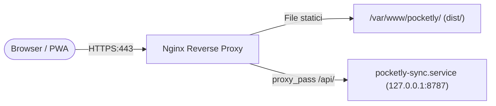

---
source-files:
  - deploy/proxmox/README.md
  - deploy/proxmox/install-sync.sh
  - deploy/proxmox/update.sh
  - deploy/proxmox/publish.sh
  - deploy/proxmox/make-cert.sh
  - deploy/proxmox/pocketly-sync.service
  - deploy/proxmox/nginx/pocketly.conf
  - vite.config.ts
verified: 2026-11-12
---

# Architettura di Deploy e Infrastruttura

Questo documento illustra le modalità di pubblicazione di Pocketly, con particolare riferimento all'ambiente self-hosted raccomandato su Proxmox LXC e alla configurazione di sviluppo locale.

---

## 1. Architettura di Rete e Reverse Proxy

In produzione su server Linux (es. Debian in Proxmox LXC), Nginx funge da punto d'ingresso HTTPS unico per il frontend statico e per il server Python:



### Configurazione Nginx (`deploy/proxmox/nginx/pocketly.conf`)
- Porta 80: serve solo `/ca.crt` (il certificato pubblico della CA locale, da installare sui dispositivi) e reindirizza tutto il resto in HTTPS.
- Terminazione TLS (TLS 1.2/1.3) con il certificato emesso dalla CA locale creata con `make-cert.sh`.
- Caching aggressivo per gli asset con hash (`/assets/*` e moduli generati `/workbox-*.js`: `Cache-Control: public, max-age=31536000, immutable`).
- Nessun caching per `index.html`, `/sw.js` e `/push-worker.js` (`Cache-Control: no-cache, no-store, must-revalidate; Pragma: no-cache; Expires: 0`); `/manifest.webmanifest` è servito come `application/manifest+json` con `Cache-Control: no-cache, no-store, must-revalidate`.
- Blocco `/api/`: inoltro a `http://127.0.0.1:8787` con header `Host` e `X-Real-IP` (è l'indirizzo che il server usa per il rate limiting, `client_ip`) e `Cache-Control: no-store`.
- Limite dimensione body HTTP su `/api/`: `client_max_body_size 6m` (il server rifiuta comunque corpi oltre 5 MB, `MAX_BODY_BYTES`).

---

## 2. Servizio Systemd (`pocketly-sync.service`)

Il backend Python viene eseguito come servizio di sistema non-root (`pocketly`). Estratto della unit (`install-sync.sh` sostituisce il segnaposto `@REPO@` con la cartella del repository, di solito `/opt/pocketly`; il file completo ha altre direttive di isolamento):

```ini
[Unit]
Description=Pocketly sync server
After=network.target

[Service]
Type=simple
User=pocketly
Group=pocketly
EnvironmentFile=/etc/pocketly/sync.env
Environment=POCKETLY_HOST=127.0.0.1
Environment=POCKETLY_PORT=8787
Environment=POCKETLY_DATA_DIR=/var/lib/pocketly
ExecStart=/usr/bin/python3 @REPO@/server/main.py
Restart=on-failure
RestartSec=5

# Isolamento di sicurezza del filesystem
StateDirectory=pocketly
StateDirectoryMode=0700
NoNewPrivileges=true
ProtectSystem=strict
ProtectHome=true
PrivateTmp=true
PrivateDevices=true

[Install]
WantedBy=multi-user.target
```

---

## 3. Ambiente di Sviluppo Locale con Proxy Vite

Durante lo sviluppo locale, il frontend viene eseguito con Vite sulla porta 5173 e il server Python sulla porta predefinita 8787. In [`vite.config.ts`](../../vite.config.ts) è configurato il proxy di sviluppo:

```ts
server: {
  proxy: {
    '/api': 'http://127.0.0.1:8787',
  },
}
```

Questo consente al frontend di effettuare chiamate a `/api/sync` e `/api/push/*` senza problemi di CORS (Cross-Origin Resource Sharing), simulando fedelmente l'ambiente di produzione.

---

## 4. Script di Installazione e Aggiornamento Proxmox

Nella cartella [`deploy/proxmox/`](../../deploy/proxmox/) sono presenti script pronti all'uso:
- `install-sync.sh` (da root, nel container): installa `python3` se manca, crea l'utente di sistema `pocketly`, genera la chiave `POCKETLY_SYNC_KEY` in `/etc/pocketly/sync.env` solo la prima volta e la mostra, vi scrive il contatto VAPID se è impostata `POCKETLY_VAPID_SUBJECT=mailto:...`, installa e avvia la systemd unit e aggiorna la configurazione di Nginx (la precedente resta come `.bak`). La cartella dati `/var/lib/pocketly` (permessi `0700`) la crea systemd con `StateDirectory`.
- `publish.sh` (dal PC): compila il frontend (`npm run build`) e carica `dist/` via SSH nella cartella del sito (default `/var/www/pocketly`) con uno scambio di cartelle; ricarica Nginx su SSH se installato.
- `update.sh` (nel container, dentro la copia del repository): `git pull --ff-only`, `npm ci`, `npm run build`, sostituzione del sito, allineamento di `/etc/nginx/sites-available/pocketly` quando la configurazione del repository è cambiata (la precedente resta in `.bak`; se `nginx -t` fallisce viene rimessa e nginx non si tocca) con reload di Nginx e, se installato, riavvio di `pocketly-sync`.
- `make-cert.sh`: crea una piccola CA locale (riusata se esiste già) e un certificato per l'IP del container, per reti domestiche senza dominio pubblico.

La guida passo passo completa per Proxmox LXC è disponibile in [deploy/proxmox/README.md](../../deploy/proxmox/README.md).
