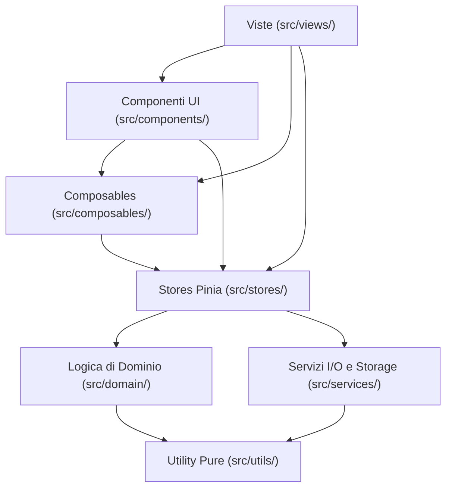

---
source-files:
  - src/App.vue
  - src/main.ts
  - src/router/index.ts
  - src/style.css
  - src/stores/finance.ts
  - src/stores/sync.ts
  - src/stores/notifications.ts
  - src/stores/backup.ts
  - src/stores/ui.ts
  - src/composables/useMonthStep.ts
  - src/composables/useConfirmDelete.ts
  - src/composables/useDirty.ts
  - src/components/BalancePanel.vue
  - src/components/BaseModal.vue
  - src/components/BottomNav.vue
  - src/components/MonthSelector.vue
  - src/components/SubmitButton.vue
  - src/views/BreakdownDetailView.vue
  - src/views/DashboardView.vue
  - src/i18n/index.ts
  - vite.config.ts
verified: 2026-11-11
---

# Architettura Frontend

Il frontend di Pocketly è una Single Page Application (SPA) e Progressive Web App (PWA) sviluppata con **Vue 3** e **TypeScript**, servita tramite **Vite**.

---

## 1. Struttura a Strati (Layering)

L'architettura del codice segue una rigorosa separazione delle responsabilità:



1. **Viste (`src/views/`):**
   Rappresentano le 9 pagine accessibili tramite URL (8 schermate principali dai tab di navigazione + 1 vista di dettaglio analitico). Coordinano i componenti e collegano lo stato dello store Pinia alla UI. Non implementano formule matematiche finanziarie o calcoli contabili.
2. **Componenti (`src/components/`):**
   Moduli riutilizzabili per form (`TransactionForm`, `LoanForm`, `RecurringForm`), modali (`BaseModal`), badge di tag (`TagBadge`), grafici a barre (`BudgetBar`), selettori mese (`MonthSelector`), gestione notifiche e toast.
3. **Composables (`src/composables/`):**
   Funzioni di logica reattiva condivisa:
   - `useMonthStep.ts`: il mese prima o dopo quello scelto, con passaggio all'anno vicino solo se compare nel menu dell'anno. È condiviso tra le frecce ‹ › e i tasti ←/→ di `MonthSelector.vue` e lo swipe sul riquadro principale, gestito in `DashboardView.vue`. Da "Tutti i mesi" (`'all'`) le frecce entrano nei mesi: nell'anno in corso ‹ porta al mese prima di oggi e › a quello dopo (se quel mese cade in un anno assente dal menu, al mese di oggi); in un altro anno ‹ porta a dicembre e › a gennaio. Al mese di oggi porta il pulsante "Questo mese" di `MonthSelector`.
   - `useDirty.ts`: dice se i campi di un modulo sono cambiati dall'apertura (`dirty`, azzerato da `reset()` dopo aver riempito i campi). Lo usano i quattro moduli per passare `dirty` a `BaseModal`.
   - `useConfirmDelete.ts`: incapsula la richiesta di conferma prima di azioni distruttive tramite dialogo modale (`ui.confirm`).
4. **Stores (`src/stores/`):**
   Gestiscono lo stato reattivo globale tramite Pinia:
   - `finance`: gestisce `FinanceData`, anno/mese correnti selezionati, calcoli aggregati e mutazioni dati.
   - `sync`: stato del collegamento con il server di sincronizzazione, credenziali e polling.
   - `notifications`: sottoscrizioni Web Push locali e remote, pianificazione promemoria.
   - `backup`: monitoraggio dell'età dell'ultimo backup esportato e promemoria periodico.
   - `ui`: messaggi toast temporanei (errori 10 secondi, chiudibili con `dismissToast`), apertura rapida del modulo "nuova spesa" (`quickAddOpen`) e dialoghi di conferma (`confirm`, con `cancelLabel` facoltativo; di serie "Annulla").
5. **Dominio (`src/domain/`):**
   Funzioni TypeScript pure senza dipendenze dalla reattività di Vue o dal DOM. Totalmente coperte da test unitari veloci.
6. **Servizi (`src/services/`):**
   Interfacce con il mondo esterno (I/O): IndexedDB (`storage.ts`), crittografia Web Crypto (`backupCrypto.ts`, `webpushCrypto.ts`), chiamate REST (`sync/api.ts`, `notifications/api.ts`), import/export Excel (`xlsx/`, `excelImport.ts`), migrazione versioni (`migration.ts`).
7. **Utility (`src/utils/`):**
   Funzioni ausiliarie per date (`dates.ts`), formattazione valuta (`money.ts`), generazione ID unici (`id.ts`, `uuidv5.ts`), hash SHA-256 (`hash.ts`), palette colori (`colors.ts`).

---

## 2. Reattività e Flusso Dati nello Store `finance`

Nello store [`finance.ts`](../../src/stores/finance.ts):
- I dati finanziari (`FinanceData`) sono mantenuti in un `ref<FinanceData>`.
- All'avvio dell'applicazione il mese selezionato (`selectedMonth`) viene impostato sul mese corrente di calendario (`new Date().getMonth()`), facilitando la consultazione immediata del periodo in corso senza memorizzare mesi obsoleti tra riaperture successive.
- Tutte le proprietà riassuntive (come `summary`, `forecastRows`, `monthSummaryData`, `incomesOfYear`) sono definite come `computed` e delegano direttamente a funzioni del modulo `src/domain/calculations.ts`.
- Le modifiche vengono salvate con salvataggio debounce (`scheduleSave`), che pianifica la scrittura su IndexedDB tramite l'interfaccia `DataStore` e, se la sync è attiva, invoca la sincronizzazione verso il server.
- Il metodo `flush()` permette di forzare la scrittura immediata su disco evitando che modifiche in sospeso vadano perse prima di navigazioni o chiusure.

---

## 3. Routing e Navigazione

Il router è configurato in [`src/router/index.ts`](../../src/router/index.ts):
- Modalità `createWebHistory()`.
- La vista `/` (`DashboardView`) è importata in modo sincrono per velocizzare il First Contentful Paint.
- Tutte le altre viste (`/una-tantum`, `/ricorrenti`, `/entrate`, `/budget`, `/prestiti`, `/previsioni`, `/impostazioni`, e la vista di dettaglio `/dettaglio/:kind(categoria|metodo)/:id`) utilizzano il caricamento asincrono (dynamic `import()`) per ridurre il bundle iniziale.
- Eventuali rotte non corrispondenti reindirizzano a `/`.
- I tab della barra inferiore sono definiti nella costante esportata `TABS`, utilizzata dal componente [`BottomNav.vue`](../../src/components/BottomNav.vue).
- **Routing gerarchico e `meta.navParent`:**
  Le viste di secondo livello o di approfondimento non possiedono una tab autonoma nella barra di navigazione. Per rendere evidente il contesto di appartenenza, definiscono nei metadati di rotta la proprietà `meta.navParent` con il nome della vista genitore (es. `/dettaglio/:kind(categoria|metodo)/:id` specifica `meta: { navParent: 'dashboard' }`). [`BottomNav.vue`](../../src/components/BottomNav.vue) interroga `route.meta.navParent` e mantiene evidenziata la tab padre sia su dispositivi mobili (`!text-emerald-700 font-bold`) sia nella barra laterale desktop (`!bg-emerald-50 !text-emerald-700`).
- **Comportamento dello scroll (`scrollBehavior`):**
  Il router adotta la politica `(_to, _from, savedPosition) => savedPosition ?? { top: 0 }`. Quando si torna indietro nella cronologia dalla schermata di dettaglio alla dashboard, la pagina ripristina la posizione di scorrimento esatta in cui si trovava in precedenza; per qualsiasi altra transizione l'utente viene riposizionato in cima alla pagina.

---

## 4. Internazionalizzazione (i18n)

L'internazionalizzazione è gestita tramite `vue-i18n` in [`src/i18n/`](../../src/i18n/):
- Due lingue supportate: Italiano (`it.ts`) e Inglese (`en.ts`).
- La lingua attiva è memorizzata e recuperata con persistenza.
- Il composable `useFormat()` ([`src/i18n/index.ts`](../../src/i18n/index.ts)) fornisce helper uniformi per:
  - `t(key, params)` per traduzioni con interpolazione.
  - `money(cents)` per formattazione valuta secondo la convenzione locale (€ con separatori appropriati).
  - `amountInput(cents)` per precompilare un campo importo con il separatore decimale della lingua ("13,00", non "13.00").
  - `date(iso)` e `month(index, style?)` per la localizzazione delle date di calendario.
  - `percent(val)` per formattazione percentuale.
- **Invariante:** le chiavi in `it.ts` e `en.ts` devono sempre coincidere. Lo script di verifica `npm run docs:check` verifica automaticamente l'assenza di chiavi orfane.

---

## 5. PWA, Service Worker e Aggiornamenti

La configurazione PWA risiede in [`vite.config.ts`](../../vite.config.ts) tramite `vite-plugin-pwa`:
- Modalità: `generateSW` con Workbox.
- Pre-caching completo di asset statici, HTML, JS, CSS e font FontAwesome WOFF2.
- Service worker dedicato per notifiche push: per le notifiche Web Push su browser Chromium/Firefox in background viene registrato il push listener capace di mostrare la notifica anche quando la pagina principale è chiusa.
- Il componente [`UpdatePrompt.vue`](../../src/components/UpdatePrompt.vue) ascolta l'evento di rilascio di una nuova versione del service worker e mostra all'utente un banner discreto per ricaricare l'app senza perdere sessioni o dati in corso di digitazione.

---

## 6. Layout, Accessibilità e Design Semantico

Lo stile globale in [`src/style.css`](../../src/style.css) è integrato con Tailwind CSS 4:
- **Aspetto per piattaforma e tema:**
  L'app segue le convenzioni del sistema su cui gira (iPhone e iPad, Android, PC) e il tema chiaro o scuro. Lo store [`appearance`](../../src/stores/appearance.ts) riconosce la piattaforma con `detectPlatform` ([`src/utils/platform.ts`](../../src/utils/platform.ts)) e segue `prefers-color-scheme`; dalle Impostazioni si possono fissare a mano. Il risultato va su `<html>` come `data-platform` (`ios` / `android` / `desktop`) e `data-theme` (`light` / `dark`) prima del primo disegno (in `main.ts`, prima di `mount`).
- **Cornice e colori per piattaforma:**
  Oltre allo scuro, `style.css` ha i valori dei gettoni per `html[data-platform='ios']` (grigi di sistema di Apple, fondo raggruppato `#f2f2f7` / nero) e `html[data-platform='android']` (ruoli di Material 3 ricavati dal verde di Pocketly), ciascuno con la sua variante scura. Il carattere segue la piattaforma: di sistema su iPhone, Roboto su Android, Inter sul PC, inclusi come pacchetti `@fontsource` (solo i caratteri latini) e quindi disponibili offline. Intestazione, barra in basso, titoli e selettore del mese cambiano struttura per piattaforma (`AppHeader`, `BottomNav`, `PageHeader`, `MonthSelector`); i riquadri (`card`, `panel`) prendono la forma della piattaforma da regole di `style.css` fuori dai layer (iPhone: senza bordo né ombra, angoli 14 px; Android: angoli 16 px); su Android il "+" è un pulsante flottante e il contenuto ha più spazio in fondo (`App.vue`). Lo store `appearance` aggiorna anche `meta[name=theme-color]` con il colore del fondo, così la barra di sistema del telefono segue il tema.
- **Fogli e moduli per piattaforma:**
  Le finestre (`BaseModal`, classe `sheet`) salgono dal basso con la maniglia sul telefono. Su iPhone il foglio è grigio (al buio il grigio "elevato" `#1c1c1e`) e, se contiene un modulo (prop `formId`), la barra in alto è "Annulla · titolo · Fine": Fine è un `<button type="submit" form=…>` che invia il modulo, e i pulsanti in fondo spariscono. Su Android il foglio ha angoli di 28 px e titolo grande a sinistra, niente ✕ nei moduli, e in fondo "Annulla" di testo e "Salva" a pillola, a destra. Sul PC la finestra resta com'era. I campi cambiano forma da regole di `style.css` fuori dai layer: nei fogli (`.sheet .field`) su iPhone bianchi senza bordo, alti 44 px, e su Android a contorno, alti 56 px, con l'etichetta (`.field-label`) appoggiata sul bordo; nelle pagine su iPhone grigi senza bordo e su Android a contorno con angoli piccoli, all'altezza di sempre perché spesso stanno in riga con un pulsante. I campi piccoli accanto a un pulsante hanno `field-compact` e tengono la loro misura.
- **Liste e pagine per piattaforma:**
  Sul telefono le righe delle liste (`EntryRow`) si aprono al tocco e si elimina dal modulo ("Elimina" in fondo, prop `deletable` dei moduli ed evento `delete` gestito dalla pagina); sul PC restano matita e cestino. Tutte le pagine tranne dashboard e dettaglio usano `PageHeader`, quindi hanno il titolo della piattaforma; il loro pulsante "Aggiungi" (`page-add`) è tenue a pillola sul telefono. Testo grigio: `ink-4` è il grigio più chiaro ammesso per il testo (4,5:1 sul bianco); `ink-5` resta per icone decorative. Il rosso del testo (`negative`) è rose 700 in chiaro, perché spesso è testo piccolo; il verde delle cifre è `accent` (`accent-icon` solo per le icone).
- **Gettoni di colore:**
  Nei componenti non ci sono colori fissi di Tailwind (`text-slate-700`, `bg-emerald-50`…): si scrivono gettoni con nomi di significato, definiti in `@theme inline` in [`src/style.css`](../../src/style.css) e valorizzati dalle variabili `--pk-*`. Famiglie: `canvas` (fondo della pagina); `surface`, `surface-2`…`-4` (superfici dal bianco al grigio); `line-soft` / `line` / `line-strong`; `ink-strong`, `ink`, `ink-2`…`ink-6` (testo dal più scuro al più chiaro); `on-color` (testo e icone sopra le tinte piene); `accent…` (il verde delle azioni, dal `-soft` al `-strongest`); `positive…` (il blu del risultato); `negative…` (sotto zero, errori); `caution…` (attenzione); `recurring…`, `variable`, `sync…`; `chrome…` (l'intestazione scura). Per ora ogni tonalità usata ha il suo gettone, con lo stesso valore dei colori di prima; le regole `html[data-platform=…]` e `html[data-theme=dark]` cambiano solo i valori. I fondi pieni con testo bianco sopra (pulsanti, toast d'errore, barre) usano gettoni separati `…-fill` (`accent-fill`, `negative-fill`, `recurring-fill`, `caution-fill`…), perché nello scuro il testo colorato si schiarisce mentre il fondo di un pulsante deve restare abbastanza scuro da reggere il bianco. Lo scuro è il blocco `:root[data-theme='dark']` in `style.css`: testi e linee chiari su grigio-blu scuro, tinte tenui come trasparenze della tinta piena; lo store `appearance` imposta anche `color-scheme`, così campi data, menu e barre di scorrimento seguono il tema. Un componente nuovo usa solo i gettoni; i neri trasparenti degli sfondi dietro le finestre (`bg-black/60`) restano tali in ogni tema.
- **Scroll Padding e Safe Area:**
  L'intestazione in alto ([`AppHeader.vue`](../../src/components/AppHeader.vue)) e la barra di navigazione inferiore ([`BottomNav.vue`](../../src/components/BottomNav.vue)) sono ancorate fisse. Per impedire che la tastiera virtuale o la navigazione con tasti freccia copra l'elemento su cui è posizionato il focus, `src/style.css` definisce:
  ```css
  scroll-padding-top: calc(5rem + env(safe-area-inset-top));
  scroll-padding-bottom: calc(5rem + env(safe-area-inset-bottom));
  ```
  Su schermi desktop (`min-width: 48rem`) il padding inferiore viene ridotto automaticamente a `1rem`.

### Convenzione Cromatica Semantica (Uso del Rosso)

Nel design visivo di Pocketly, il colore rosso (`text-rose-600`) adotta un principio di massima parsimonia: **ha un unico significato ed è riservato esclusivamente a valori contabili negativi / sotto zero** (deficit contabile effettivo o previsto).
- **Neutralità per spese ordinarie e zeri:** Le uscite contabili ([`BalancePanel.vue`](../../src/components/BalancePanel.vue), [`BreakdownDetailView.vue`](../../src/views/BreakdownDetailView.vue)) e gli importi pari a zero sono visualizzati in colore neutro (`text-slate-800`), evitando falsi allarmismi per le normali spese contabili.
- **Entrate condizionate:** Le entrate compaiono in verde (`text-emerald-700`) solo quando l'importo è strettamente positivo (`> 0`); se l'importo è nullo, rimane in colore neutro (`text-slate-800`).
- **Cifra grande del riquadro principale:** In [`BalancePanel.vue`](../../src/components/BalancePanel.vue) la cifra grande (il previsto a fine periodo, o il risultato finale per un periodo passato) usa `signColor`: blu (`text-blue-600`) se `>= 0`, rosso se `< 0`. Fa eccezione la cifra positiva solo grazie alle entrate stimate (`estimateDecisive` in [`DashboardView.vue`](../../src/views/DashboardView.vue), passato come `main.neutral`): resta neutra (`text-slate-800`), perché il blu non deve promettere "va bene" su soldi non ancora arrivati. Il risultato fino a oggi, sotto la cifra, è sempre neutro. Per un mese passato, oltre al colore, una frase confronta il risultato con la media dei mesi precedenti dell'anno (`averageBalanceBefore`, `compareToAverage`).
- **Scadenze ravvicinate in ambra:** Nei prossimi addebiti ([`DashboardView.vue`](../../src/views/DashboardView.vue)), le scadenze imminenti (`daysLeft <= 3`) mantengono l'importo in grigio neutro (`text-slate-700`) e spostano l'evidenziazione visiva sull'elemento temporale ("quando"), evidenziato in ambra caldo (`text-amber-700 font-medium`). In questo modo, l'eventuale comparsa del colore rosso cattura immediatamente l'attenzione perché indica un reale disavanzo senza copertura.

### Accessibilità e Navigazione da Tastiera

- **Focus programmatico e annunci contestuali:**
  Nella vista di approfondimento [`BreakdownDetailView.vue`](../../src/views/BreakdownDetailView.vue), il caricamento aggiorna dinamicamente `document.title` (`"{name} · Pocketly"`) e trasferisce programmaticamente il focus al titolo `h2` (`tabindex="-1"`, con contorno visivo pulito `focus:outline-none`). In questo modo chi utilizza screen reader o naviga via tastiera recepisce all'istante il cambio di contesto senza dover riattraversare la barra superiore o i controlli globali. Al disallestimento (`onBeforeUnmount`), il titolo precedente viene ripristinato.
- **Ritorno dal dettaglio:**
  "Torna alla dashboard" in `BreakdownDetailView.vue` è un `<a href="/">` normale, non un `RouterLink` (che navigherebbe da solo prima del gestore `back`). Con Ctrl/Cmd/Maiusc/Alt o il tasto centrale il clic resta al browser (es. nuova scheda). Altrimenti, se `router.options.history.state.back === '/'` invoca `router.back()`, così `scrollBehavior` ripristina la posizione di scorrimento; aprendo la pagina direttamente (bookmark, ricaricamento) usa `router.push('/')`. Tornata indietro, `DashboardView.vue` legge in `onMounted` `router.options.history.state.forward` e rimette il focus sulla riga della ripartizione da cui si era entrati.
- **Navigazione mese globale e compatibilità con tasti modificatori:**
  I listener per i tasti `ArrowLeft` e `ArrowRight` sono centralizzati in [`MonthSelector.vue`](../../src/components/MonthSelector.vue) a livello di documento, consentendo lo scorrimento dei mesi da tastiera in qualsiasi schermata che includa il componente (dashboard, dettaglio analitico, spese una tantum). L'ascoltatore ignora difensivamente gli eventi se il focus è su controlli di testo (`input`, `select`, `textarea`, `contenteditable`) o quando è aperta una finestra modale (`[aria-modal="true"]` nel documento). Inoltre, se l'utente preme combinazioni con modificatori (`Alt`, `Ctrl`, `Meta`, `Shift`), l'evento non viene intercettato: ciò garantisce la piena operatività delle scorciatoie native del browser come `Alt+ArrowLeft` (ritorno cronologico indietro) ed evita interferenze con le funzioni di sistema operativo o accessibilità.
- **Preservazione del focus e feedback ARIA nel selettore mese:**
  In [`MonthSelector.vue`](../../src/components/MonthSelector.vue), il pulsante rapido "Questo mese" trasferisce programmaticamente il focus al menu a tendina `<select>` (`select.value?.focus()`) prima di nascondersi, evitando che il focus rimanga orfano nel DOM. Similmente, quando l'avanzamento o il retrocesso tramite le frecce passo-passo (‹ e ›) disabilita il pulsante per aver raggiunto il limite cronologico degli anni censiti, il focus passa automaticamente al `<select>`. Inoltre, le frecce adattano dinamicamente `aria-label` e `title` ("Vai a {month}" quando si proviene da "Tutti i mesi", "Mese precedente/successivo: {month}" all'interno dei mesi).
- **Supporto touch, chiusura dialoghi e aree minime:**
  I pulsanti interattivi e le righe cliccabili (come le ripartizioni [`BreakdownList.vue`](../../src/components/BreakdownList.vue) con prop `linked`) mantengono un'area minima di tocco di 40px/44px. Gli annunci vocali (`aria-live="polite"`) informano gli utenti di lettori di schermo sui cambi di periodo. Il menu compatto ([`BottomNav.vue`](../../src/components/BottomNav.vue)) si chiude con il tasto `Escape`.
- **Finestre modali ([`BaseModal.vue`](../../src/components/BaseModal.vue)):**
  All'apertura il focus va sul titolo della finestra (il lettore di schermo annuncia dove si è e sul telefono non si apre la tastiera); alla chiusura torna sull'elemento che l'ha aperta, se esiste ancora. Finché una finestra è aperta `#app` è `inert` (le finestre sono in `Teleport` sul `body`). Le finestre aperte formano una pila a livello di modulo: ognuna riceve uno `z-index` crescente (una conferma sta sopra il modulo) e solo quella in cima risponde a `Escape` e al Tab, che gira dentro la finestra. Con la prop `dirty` (da `useDirty`), chiudere con `Escape`, ✕ o clic sullo sfondo chiede prima "Scartare le modifiche?" via `ui.confirm` (con `cancelLabel` "Continua a modificare"); il pulsante "Annulla" del modulo (`SubmitButton` con `cancelLabel`, o quello nella barra del foglio su iPhone) chiude subito.
