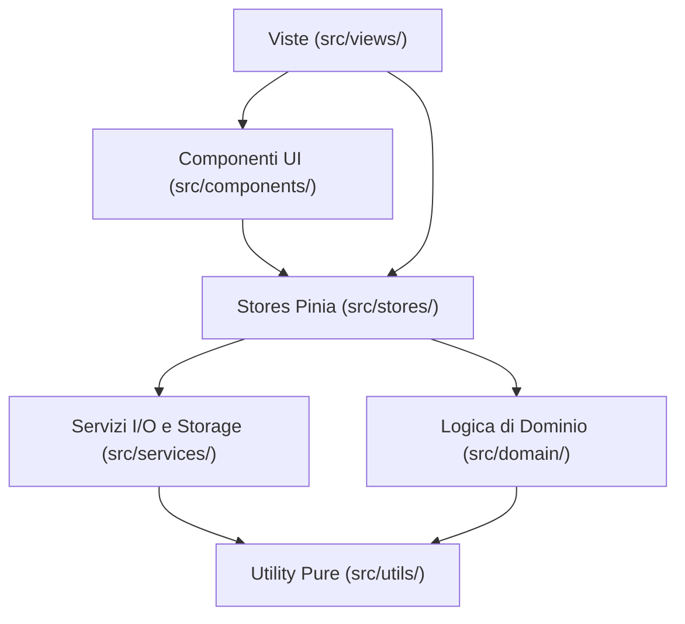

---
source-files:
  - src/App.vue
  - src/main.ts
  - src/router/index.ts
  - src/style.css
  - src/stores/finance.ts
  - src/stores/sync.ts
  - src/stores/notifications.ts
  - src/stores/backup.ts
  - src/stores/ui.ts
  - src/composables/useMonthStep.ts
  - src/views/BreakdownDetailView.vue
  - src/i18n/index.ts
  - vite.config.ts
verified: 2026-11-10
---

# Architettura Frontend

Il frontend di Pocketly è una Single Page Application (SPA) e Progressive Web App (PWA) sviluppata con **Vue 3** e **TypeScript**, servita tramite **Vite**.

---

## 1. Struttura a Strati (Layering)

L'architettura del codice segue una rigorosa separazione delle responsabilità:

1. **Viste (`src/views/`):**
   Rappresentano le 9 pagine accessibili tramite URL (8 schermate principali dai tab di navigazione + 1 vista di dettaglio analitico). Coordinano i componenti e collegano lo stato dello store Pinia alla UI. Non implementano formule matematiche finanziarie o calcoli contabili.
2. **Componenti (`src/components/`):**
   Moduli riutilizzabili per form (`TransactionForm`, `LoanForm`, `RecurringForm`), modali (`BaseModal`), badge di tag (`TagBadge`), grafici a barre (`BudgetBar`), selettori mese (`MonthSelector`), gestione notifiche e toast.
3. **Stores (`src/stores/`):**
   Gestiscono lo stato reattivo globale tramite Pinia:
   - `finance`: gestisce `FinanceData`, anno/mese correnti selezionati, calcoli aggregati e mutazioni dati.
   - `sync`: stato del collegamento con il server di sincronizzazione, credenziali e polling.
   - `notifications`: sottoscrizioni Web Push locali e remote, pianificazione promemoria.
   - `backup`: monitoraggio dell'età dell'ultimo backup esportato e promemoria periodico.
   - `ui`: messaggi toast temporanei e dialoghi di conferma.
4. **Dominio (`src/domain/`):**
   Funzioni TypeScript pure senza dipendenze dalla reattività di Vue o dal DOM. Totalmente coperte da test unitari veloci.
5. **Servizi (`src/services/`):**
   Interfacce con il mondo esterno (I/O): IndexedDB (`storage.ts`), crittografia Web Crypto (`backupCrypto.ts`, `webpushCrypto.ts`), chiamate REST (`sync/api.ts`, `notifications/api.ts`), import/export Excel (`xlsx/`, `excelImport.ts`), migrazione versioni (`migration.ts`).
6. **Utility (`src/utils/`):**
   Funzioni ausiliarie per date (`dates.ts`), formattazione valuta (`money.ts`), generazione ID unici (`id.ts`, `uuidv5.ts`), hash SHA-256 (`hash.ts`), palette colori (`colors.ts`).

---

## 2. Reattività e Flusso Dati nello Store `finance`

Nello store [`finance.ts`](../../src/stores/finance.ts):
- I dati finanziari (`FinanceData`) sono mantenuti in un `ref<FinanceData>`.
- All'avvio dell'applicazione il mese selezionato (`selectedMonth`) viene impostato sul mese corrente di calendario (`new Date().getMonth()`), facilitando la consultazione immediata del periodo in corso senza memorizzare mesi obsoleti tra riaperture successive.
- Tutte le proprietà riassuntive (come `summary`, `forecastRows`, `monthSummaryData`, `incomesOfYear`) sono definite come `computed` e delegano direttamente a funzioni del modulo `src/domain/calculations.ts`.
- Le modifiche vengono salvate con salvataggio debounce (`scheduleSave`), che pianifica la scrittura su IndexedDB tramite l'interfaccia `DataStore` e, se la sync è attiva, invoca la sincronizzazione verso il server.
- Il metodo `flush()` permette di forzare la scrittura immediata su disco evitando che modifiche in sospeso vadano perse prima di navigazioni o chiusure.

---

## 3. Routing e Navigazione

Il router è configurato in [`src/router/index.ts`](../../src/router/index.ts):
- Modalità `createWebHistory()`.
- La vista `/` (`DashboardView`) è importata in modo sincrono per velocizzare il First Contentful Paint.
- Tutte le altre viste (`/una-tantum`, `/ricorrenti`, `/entrate`, `/budget`, `/prestiti`, `/previsioni`, `/impostazioni`, e la vista di dettaglio `/dettaglio/:kind(categoria|metodo)/:id`) utilizzano il caricamento asincrono (dynamic `import()`) per ridurre il bundle iniziale.
- Eventuali rotte non corrispondenti reindirizzano a `/`.
- I tab della barra inferiore sono definiti nella costante esportata `TABS`, utilizzata dal componente [`BottomNav.vue`](../../src/components/BottomNav.vue).

---

## 4. Internazionalizzazione (i18n)

L'internazionalizzazione è gestita tramite `vue-i18n` in [`src/i18n/`](../../src/i18n/):
- Due lingue supportate: Italiano (`it.ts`) e Inglese (`en.ts`).
- La lingua attiva è memorizzata e recuperata con persistenza.
- Il composable `useFormat()` ([`src/i18n/index.ts`](../../src/i18n/index.ts)) fornisce helper uniformi per:
  - `t(key, params)` per traduzioni con interpolazione.
  - `money(cents)` per formattazione valuta secondo la convenzione locale (€ con separatori appropriati).
  - `date(iso)` e `month(index)` per la localizzazione delle date di calendario.
  - `percent(val)` per formattazione percentuale.
- **Invariante:** le chiavi in `it.ts` e `en.ts` devono sempre coincidere. Lo script di verifica `npm run docs:check` verifica automaticamente l'assenza di chiavi orfane.

---

## 5. PWA, Service Worker e Aggiornamenti

La configurazione PWA risiede in [`vite.config.ts`](../../vite.config.ts) tramite `vite-plugin-pwa`:
- Modalità: `generateSW` con Workbox.
- Pre-caching completo di asset statici, HTML, JS, CSS e font FontAwesome WOFF2.
- Service worker dedicato per notifiche push: per le notifiche Web Push su browser Chromium/Firefox in background viene registrato il push listener capace di mostrare la notifica anche quando la pagina principale è chiusa.
- Il componente [`UpdatePrompt.vue`](../../src/components/UpdatePrompt.vue) ascolta l'evento di rilascio di una nuova versione del service worker e mostra all'utente un banner discreto per ricaricare l'app senza perdere sessioni o dati in corso di digitazione.
