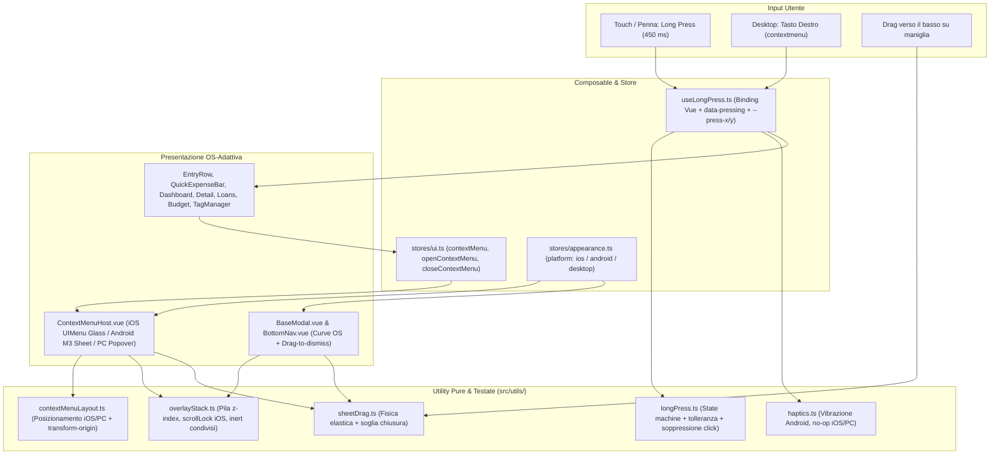

---
source-files:
  - src/style.css
  - src/App.vue
  - src/stores/ui.ts
  - src/stores/appearance.ts
  - src/utils/modalViewport.ts
  - src/components/BaseModal.vue
  - src/components/BottomNav.vue
  - src/components/EntryRow.vue
  - src/components/QuickExpenseBar.vue
  - src/components/QuickExpenseForm.vue
  - src/components/TagManager.vue
  - src/components/settings/SettingsAboutSection.vue
  - src/views/DashboardView.vue
  - src/views/BreakdownDetailView.vue
  - src/views/OneTimeView.vue
  - src/views/RecurringView.vue
  - src/views/IncomeView.vue
  - src/views/LoansView.vue
  - src/views/BudgetView.vue
verified: 2026-11-25
---

# Progetto e Piano Implementativo: Interazione Nativa PWA, Long Press e Animazioni OS-Adattive (PKT-28)

Questo documento definisce l'architettura tecnica, le scelte di design per sistema operativo e la guida operativa per introdurre in **Pocketly** un comportamento realmente nativo da app (eliminazione dei comportamenti web indesiderati, pressione prolungata con menu contestuale dinamico e animazioni/gesture coerenti con **iOS**, **Android** e **Desktop**), tracciata in [Backlog di Pocketly](../backlog.md) sotto **PKT-28**.

---

## 1. Obiettivo e Decisioni Progettuali Confermate

Pocketly adatta già colori, caratteri, cornice, barra inferiore e moduli alla piattaforma attiva (`data-platform="ios" | "android" | "desktop"` in [`appearance.ts`](../../src/stores/appearance.ts) e [`style.css`](../../src/style.css)). L'obiettivo di `PKT-28` è allineare allo stesso livello anche **l'interazione tattile, il feedback visivo/aptico, i menu contestuali e la fisica delle animazioni**, senza introdurre dipendenze esterne né modificare il formato dei dati (`FinanceData` v3) o il backend Python.

| Asse | Decisione confermata |
|---|---|
| **Selezione testo (Mobile vs Desktop)** | Su **iOS e Android**: `user-select: none` e `-webkit-touch-callout: none` globali su `body`, con riabilitazione esplicita (`user-select: text; -webkit-touch-callout: default`) su `input`, `textarea`, `[contenteditable="true"]` e sugli elementi copiabili marcati `.selectable` (es. versione/build in [`SettingsAboutSection.vue`](../../src/components/settings/SettingsAboutSection.vue)). Su **Desktop / PC**: `user-select: none` solo sulla chrome UI e sui controlli interattivi, lasciando selezionabili i testi di contenuto e le tabelle. |
| **Comportamento PWA shell** | Blocco callout iOS (`-webkit-touch-callout: none`), blocco trascinamento fantasma icone/immagini (`-webkit-user-drag: none`), `overscroll-behavior-y: none` (niente pull-to-refresh involontario su Android), `touch-action: manipulation` sui controlli interattivi (niente zoom da doppio tap, preservando pinch-to-zoom di accessibilità). |
| **Trigger Menu Contestuale** | **Touch / Penna:** pressione prolungata (`450 ms`) con ritardo di armamento (`110 ms`) e tolleranza di movimento (`10 px`) per non interferire mai con scroll o swipe. **Desktop / PC:** apertura immediata anche con **tasto destro (`contextmenu`)** su righe, pillole e card supportate, mantenendo invariati i pulsanti matita/duplica/cestino esistenti. |
| **Presentazione dinamica per OS** | Un unico host globale (`ContextMenuHost.vue`) che adatta layout, materiali, posizionamento e curve di animazione a `appearance.platform` su tutte e 6 le combinazioni piattaforma × tema (solo gettoni semantici, Invariante #8 di [AGENTS.md](../../AGENTS.md)). |
| **Coerenza fogli e modali** | Allineamento delle transizioni di [`BaseModal.vue`](../../src/components/BaseModal.vue) e del pannello «Altro» di [`BottomNav.vue`](../../src/components/BottomNav.vue) alle stesse curve OS-native, con gesto **drag-to-dismiss** confinato alla testata/maniglia (`touch-none`) così da preservare integralmente il blocco scroll e gli scroller orizzontali di `PKT-26` ([`modalViewport.ts`](../../src/utils/modalViewport.ts)) e la guardia `dirty`. |
| **Accessibilità e fallback** | Ogni azione presente nel menu contestuale resta raggiungibile tramite tap normale, pulsanti espliciti e tastiera (`role="menu"` / `role="menuitem"`, `ArrowUp`/`ArrowDown`/`Home`/`End`/`Enter`/`Escape`, ripristino del focus, rispetto integrale di `prefers-reduced-motion`). |

---

## 2. Architettura a Strati

La logica non banale (state machine long press, calcolo posizionamento popover, fisica drag-to-dismiss, pila condivisa degli overlay e feedback aptico) è confinata in utility TypeScript pure in `src/utils/` coperte da test unitari Vitest (ambiente `node`, sul modello di [`modalViewport.ts`](../../src/utils/modalViewport.ts)).



---

## 3. Matrice Standard Grafici e Animazioni per Sistema Operativo

| Aspetto | **iOS** (`data-platform="ios"`) | **Android** (`data-platform="android"`) | **Desktop / PC** (`data-platform="desktop"`) |
|---|---|---|---|
| **Pattern nativo** | Haptic Touch `UIMenu` flottante (*Liquid Glass*) | Material 3 Expressive Modal Bottom Sheet | Context Menu Popover al cursore |
| **Curve di movimento** | Enter `cubic-bezier(0.32, 0.72, 0, 1)` · Spring `cubic-bezier(0.22, 1.2, 0.36, 1)` · Exit `cubic-bezier(0.32, 0, 0.67, 0)` | M3 Emphasized Decelerate `cubic-bezier(0.05, 0.7, 0.1, 1)` · Accelerate `cubic-bezier(0.3, 0, 0.8, 0.15)` | Snappy `cubic-bezier(0.16, 1, 0.3, 1)` / `cubic-bezier(0.4, 0, 1, 1)` |
| **Durate (sheet / menu)** | `320 ms` in / `220 ms` out · menu `240 ms` / `160 ms` | `280 ms` in / `180 ms` out · menu `240 ms` / `160 ms` | `170 ms` in / `120 ms` out · menu `140 ms` / `100 ms` |
| **Feedback pressione (`110–450 ms`)** | Micro-squeeze `scale(0.975)` + leggero highlight (pre-caricamento *pop*) | State layer radiale (`radial-gradient`) centrato su `--press-x / --press-y` | Lieve velo `var(--pk-press-overlay)` |
| **Feedback aptico** | No-op sicuro (WebKit non supporta Vibration API) | `navigator.vibrate(10)` al trigger, `[12, 30, 12]` su azioni distruttive | No-op |
| **Sfondo (Scrim)** | `bg-black/25 backdrop-blur-md` | `bg-black/45` (nessun blur) | Trasparente (click fuori chiude subito) |
| **Superficie menu** | `rounded-2xl border border-dock-border bg-dock-sheet backdrop-blur-2xl backdrop-saturate-150 shadow-2xl` | `rounded-t-[28px] bg-dock-sheet pb-safe shadow-2xl` con drag handle | `rounded-xl border border-line bg-surface p-1.5 shadow-xl` |
| **Layout voci** | Altezza `min-h-11`, testo `15px` a sinistra, **icona a destra**, `divide-y divide-line-soft`, barra `h-1.5 bg-surface-3/70` prima di azioni distruttive | Altezza `min-h-12`, `rounded-full px-4`, **icona a sinistra**, stato tonale `active:bg-surface-3`, drag-to-dismiss sulla testata | Altezza `min-h-9`, `rounded-lg px-2.5 text-sm`, **icona a sinistra**, `hover:bg-surface-2` |
| **Posizionamento** | Sopra o sotto `anchor.rect` con `transform-origin` puntato all'elemento (fallback centrato su landscape basso) | Ancorato in basso (`inset-x-0 bottom-0`, `max-w-xl mx-auto`) | Alle coordinate `(x, y)` del cursore con flip automatico sui 4 quadranti entro `12 px` dal bordo |

---

## 4. Specifiche Tecniche Operative (Guida per PKT-28)

Le modifiche sono ordinate per dipendenza logica. È consigliato lavorare in un ramo dedicato (es. `feature/pkt-28-interazione-nativa`).

### Fase 1 — Native Shell CSS, Gettoni di Colore e Movimento

- **File:** [`src/style.css`](../../src/style.css)
  1. Aggiungere il gettone `--pk-press-overlay` in **tutti e 6 i blocchi** (`:root`, `:root[data-theme='dark']`, `:root[data-platform='ios']`, `:root[data-platform='ios'][data-theme='dark']`, `:root[data-platform='android']`, `:root[data-platform='android'][data-theme='dark']`) rispettando l'Invariante #8 (le regole Android vengono dopo lo scuro: Android scuro va ridetto esplicitamente).
  2. Definire i gettoni di movimento `--pk-ease-enter`, `--pk-ease-exit`, `--pk-ease-spring`, `--pk-dur-sheet-in`, `--pk-dur-sheet-out`, `--pk-dur-menu-in`, `--pk-dur-menu-out` per `:root`, `:root[data-platform='ios']` e `:root[data-platform='android']`.
  3. Aggiungere in `@layer base`:
     - `html, body { -webkit-touch-callout: none; overscroll-behavior-y: none; }`
     - `:root[data-platform='ios'] body, :root[data-platform='android'] body { user-select: none; -webkit-user-select: none; }`
     - `button, a, [role='button'], nav, header, summary, .no-select { user-select: none; -webkit-user-select: none; -webkit-touch-callout: none; }`
     - `input, textarea, [contenteditable='true'], .selectable { user-select: text; -webkit-user-select: text; -webkit-touch-callout: default; }`
     - `img, svg, i.fa-solid { -webkit-user-drag: none; }`
     - `button, a, [role='button'], summary, label, select { touch-action: manipulation; }`
  4. Aggiungere le regole per `[data-pressing='true']` (squeeze iOS, ripple radiale Android via `::after` con `--press-x`/`--press-y`, highlight Desktop) e le classi di transizione per `<Transition>` (`pk-modal-*`, `pk-ctx-ios-*`, `pk-ctx-android-*`, `pk-ctx-desktop-*`), verificate compatibili con `@media (prefers-reduced-motion: reduce)`.
- **File:** [`src/components/settings/SettingsAboutSection.vue`](../../src/components/settings/SettingsAboutSection.vue)
  - Aggiungere `.selectable` sulla riga versione/build così resti copiabile su iPhone/Android.

### Fase 2 — Utility Pure e Test Unitari (`src/utils/`)

Creare 5 moduli puri con relativi test Vitest (`environment: 'node'`):

1. **`src/utils/haptics.ts`** + **`src/utils/haptics.test.ts`**:
   - `triggerHaptic(kind: 'light' | 'medium' | 'warning', platform: Platform, nav?)`: invoca `navigator.vibrate` solo su Android con `try/catch`; no-op altrove.
2. **`src/utils/longPress.ts`** + **`src/utils/longPress.test.ts`**:
   - Costanti: `LONG_PRESS_DELAY_MS = 450`, `LONG_PRESS_FEEDBACK_DELAY_MS = 110`, `LONG_PRESS_MOVE_TOLERANCE_PX = 10`, `LONG_PRESS_CLICK_SUPPRESS_MS = 350`.
   - `createLongPressController(options)`: state machine pura con armamento feedback, annullamento su movimento oltre tolleranza, annullamento su multi-touch (`pointerId` diverso), filtro tasto mouse sinistro (`button === 0`), finestra di soppressione `shouldSuppressClick()`.
   - `isInteractiveDescendant(target, boundary)`: esclude controlli interattivi annidati (`button`, `a[href]`, `input`, `select`, `textarea`, `summary`, `[role="button"]`, `[data-no-long-press]`), riconoscendo `[data-long-press-target]` come parte del bersaglio principale (necessario per il pulsante a tutta riga di [`EntryRow.vue`](../../src/components/EntryRow.vue)).
3. **`src/utils/contextMenuLayout.ts`** + **`src/utils/contextMenuLayout.test.ts`**:
   - `computeContextMenuPosition(input)`: calcola `{ top, left, maxHeight, transformOrigin, placement }` per modalità `ios` (sopra/sotto `anchorRect` con fallback centrato su landscape basso) e `desktop` (flip automatico sui 4 quadranti dal cursore con margine `12 px`).
4. **`src/utils/sheetDrag.ts`** + **`src/utils/sheetDrag.test.ts`**:
   - `computeSheetDragOffset(deltaY)`: lineare `1:1` verso il basso, resistenza elastica verso l'alto (max `-16 px`).
   - `shouldDismissSheet({ offsetY, velocityY, sheetHeight })`: chiusura per distanza (`min(120, max(56, sheetHeight * 0.28))`) o slancio rapido (`offsetY >= 36 && velocityY >= 0.45`).
5. **`src/utils/overlayStack.ts`** + **`src/utils/overlayStack.test.ts`**:
   - Estrae e condivide la pila di [`BaseModal.vue`](../../src/components/BaseModal.vue) (`pushOverlay`, `popOverlay`, `isTopOverlay`, `isAnyOverlayOpen`, `isOverlayScrollLocked`), coordinando `z-index`, `#app.inert` e `createBackgroundScrollLock` ([`modalViewport.ts`](../../src/utils/modalViewport.ts)) senza sfarfallii nel passaggio diretto da `ContextMenuHost` a `ConfirmHost` o un modulo.

### Fase 3 — Composable Vue e Store `ui`

1. **`src/composables/useLongPress.ts`** *(nuovo)*:
   - Collega `createLongPressController`, `isInteractiveDescendant`, `triggerHaptic` e `useAppearanceStore`.
   - Espone `pressing`, `pressStyle` (`--press-x`, `--press-y`) e gli handler `pointerdown`, `pointermove`, `pointerup`, `pointercancel`, `contextmenu`, `clickCapture`.
   - Su touch/pen: blocca `contextmenu` nativo del browser; su trigger emette `onTrigger({ x, y, rect, source: 'longpress', targetEl })` e sopprime il `click` sintetico al rilascio.
   - Su mouse (tasto destro): blocca `contextmenu` e apre subito `onTrigger({ ..., source: 'contextmenu' })`.
   - Ascolta `window` `scroll` (`capture: true, passive: true`) e `blur` durante la pressione per annullarla istantaneamente allo scorrimento; pulizia automatica in `onBeforeUnmount`.
2. **[`src/stores/ui.ts`](../../src/stores/ui.ts)** + **[`src/stores/ui.test.ts`](../../src/stores/ui.test.ts)**:
   - Nuovi tipi esportati: `ContextMenuItem`, `ContextMenuAnchor`, `ContextMenuRequest`.
   - Stato `contextMenu = shallowRef<ContextMenuRequest | null>(null)` e azioni `openContextMenu(request)` / `closeContextMenu()` con relativi test unitari.

### Fase 4 — Host Globale `ContextMenuHost` e Animazioni su Modali/Navigazione

1. **`src/components/ContextMenuHost.vue`** *(nuovo)*, montato in **[`src/App.vue`](../../src/App.vue)**:
   - `<Teleport to="body">` coordinato con `overlayStack.ts`.
   - Implementa le 3 presentazioni native della Sezione 3 (`ios`, `android`, `desktop`).
   - Supporta `role="menu"` / `role="menuitem"`, navigazione completa da tastiera (`ArrowDown`, `ArrowUp`, `Home`, `End`, `Enter`, `Space`, `Escape`), drag-to-dismiss su Android, chiusura su cambio rotta (`watch(() => route.fullPath)`) e transizione pulita del focus se l'azione scelta apre un `BaseModal`.
2. **[`src/components/BaseModal.vue`](../../src/components/BaseModal.vue)**:
   - Migra la gestione della pila su `overlayStack.ts` (mantenendo `export { isAnyOverlayOpen as isAnyModalOpen }`).
   - Adotta transizioni separate per backdrop (fade) e `.sheet` (slide-up con curve iOS/M3 sotto `sm`, micro-scale su `>= sm` e Desktop).
   - Introduce il gesto **drag-to-dismiss** esclusivamente sulla testata fissa (`touch-none`) sotto `sm` su iOS e Android: al superamento della soglia invoca `requestClose()` (rispettando `dirty` e riportando il foglio in posizione se l'utente annulla).
3. **[`src/components/BottomNav.vue`](../../src/components/BottomNav.vue)**:
   - Allinea la transizione del pannello «Altro» alle curve per piattaforma (spring pop Liquid Glass su iOS, slide-up dal fondo + drag-to-dismiss sulla maniglia su Android, fade-pop rapido su Desktop).

### Fase 5 — Integrazione nei Componenti e Viste di Pocketly

| Componente / Vista | Elemento target | Azioni nel menu contestuale | Note di integrazione |
|---|---|---|---|
| [`EntryRow.vue`](../../src/components/EntryRow.vue) | Riga (`<li>`) in Variabili, Ricorrenti, Entrate | **Modifica**, **Duplica** (se `duplicable`), eventuali `contextActions`, **Elimina** (`danger`) | `data-long-press-target` sul pulsante di sfondo; tag `TagBadge clickable` e pulsante «Storico» esclusi automaticamente. |
| [`RecurringView.vue`](../../src/views/RecurringView.vue) | Righe ricorrenti (`EntryRow`) | Aggiunge **Storico** (`fa-clock-rotate-left`) tramite `contextActions` quando `hasHistory(s)` è vero | Apre il modale storico esistente (`historyKey = s.key`). |
| [`QuickExpenseBar.vue`](../../src/components/QuickExpenseBar.vue) | Pillola inserimento rapido | **Registra ora** / **Scrivi importo** (`accent`), **Modifica prima di salvare** (se importo fisso), **Modifica inserimento rapido** (apre [`QuickExpenseForm.vue`](../../src/components/QuickExpenseForm.vue) in loco), **Elimina** (`danger`) | Evita di dover navigare nelle Impostazioni per modificare/eliminare un rapido; matitina `✎` esclusa come controllo separato. |
| [`DashboardView.vue`](../../src/views/DashboardView.vue) | Righe «Prossimi addebiti» | Variabile: **Modifica**, **Duplica**, **Elimina** · Ricorrente: **Modifica**, **Salta questo addebito** (`danger`, con toast **`Annulla`** via `finance.restoreRecurringCharge`) | Usa `finance.saveRecurringException(rec, { date: original, skipped: true })` già esistente. |
| [`BreakdownDetailView.vue`](../../src/views/BreakdownDetailView.vue) | Righe dettaglio categoria/metodo | Come sopra (Variabile: Modifica/Duplica/Elimina · Ricorrente: Modifica / Salta questo addebito con Annulla) | Mantiene invariato il ripristino del focus su `data-item-key`. |
| [`LoansView.vue`](../../src/views/LoansView.vue) | Card prestito | **Aggiungi restituzione** (`accent`), **Modifica**, **Elimina** (`danger`) | Bottoni interni della card esclusi automaticamente. |
| [`BudgetView.vue`](../../src/views/BudgetView.vue) | Card salvadanaio | **Versa o Preleva** (`accent`), **Modifica**, **Elimina** (`danger`) | Chip `+10/+50/+100` e bottoni interni esclusi automaticamente. |
| [`TagManager.vue`](../../src/components/TagManager.vue) | Riga categoria / metodo / tag | **Modifica**, **Elimina** (`danger`, apre direttamente il modale di eliminazione con riassegnazione `askDelete`) | Copre entrambe le viste (raggruppata per lettera e piatta). |

### Fase 6 — i18n e Documentazione Obbligatoria

1. **Traduzioni simmetriche** in [`src/i18n/it.ts`](../../src/i18n/it.ts) e [`src/i18n/en.ts`](../../src/i18n/en.ts):
   - Nuove chiavi minime (es. `contextMenu.actions`, `quickExpenses.recordNow`, `quickExpenses.prefillShort`, `quickExpenses.editShortcut`, `recurring.chargeSkippedToast`, `recurring.chargeRestoredToast`) riutilizzando le chiavi esistenti (`common.edit`, `common.duplicate`, `common.delete`, `recurring.skipCharge`, `recurring.history`, `loans.addRepayment`, `savings.depositOrWithdraw`).
2. **Aggiornamento documentazione** nello stesso commit:
   - [`docs/riferimento/mappa-codice.md`](../riferimento/mappa-codice.md): censimento di tutti i nuovi file e test.
   - [`docs/architettura/frontend.md`](./frontend.md) e [`docs/riferimento/componenti-e-viste.md`](../riferimento/componenti-e-viste.md): descrizione del native app shell, del motore long-press/context menu e delle animazioni OS-native (con aggiornamento di `source-files` e `verified`).
   - [`docs/backlog.md`](../backlog.md): aggiornamento stato e storia di `PKT-28`.

---

## 5. Checklist di Verifica e Collaudo

### Verifiche Automatiche Obbligatorie
```bash
npm run test          # Vitest (inclusi longPress, contextMenuLayout, sheetDrag, overlayStack, haptics, ui)
npm run typecheck     # vue-tsc -b (zero errori TypeScript)
npm run test:server   # unittest server Python (nessuna regressione)
npm run build         # Build produzione + manifest/SW PWA
npm run docs:check    # Mappa codice completa, zero link rotti, i18n it/en allineato
```

### Collaudo Manuale sulle 6 Combinazioni (iPhone / Android / PC × Chiaro / Scuro)
1. **Native App Shell:**
   - Su iPhone (PWA standalone e Safari) e Android: pressione e trascinamento su testate, badge e liste non devono attivare né selezione testo né callout di sistema; `<input>`/`<textarea>` (posizionamento cursore e copia/incolla su iOS) e versione build (`.selectable`) restano pienamente selezionabili.
   - Su Desktop: chrome/bottoni non si evidenziano con doppi clic rapidi; tabelle e testi informativi restano selezionabili.
   - Nessuno zoom accidentale con doppio tap rapido sui controlli (frecce mese, chip, tab).
2. **Assenza di Conflitti con Scroll, Swipe e Controlli Figli:**
   - Scorrere liste lunghe (Variabili, Ricorrenti, Entrate, TagManager): nessun falso `data-pressing` né aperture accidentali.
   - Toccare un `TagBadge clickable` dentro `EntryRow`: filtra senza attivare il menu della riga.
   - Swipe orizzontale su `BalancePanel` in Dashboard: cambia mese come prima.
3. **Resa OS-Adattiva del Menu Contestuale:**
   - **iOS:** micro-squeeze → spring pop ancorato sopra/sotto l'elemento con sfondo sfocato, card Glass, icone a destra; verifica passaggio diretto *Elimina* → `ConfirmHost` senza salti di scroll.
   - **Android:** ripple radiale dal punto di tocco → breve vibrazione → M3 Modal Bottom Sheet dal basso con icone a sinistra e chiusura tramite drag-to-dismiss sulla maniglia.
   - **Desktop:** clic destro → Popover al cursore clampato ai bordi del viewport, navigabile interamente con `↑`/`↓`/`Home`/`End`/`Enter`/`Esc`.
   - Provare *Salta questo addebito* + *Annulla* nel toast in Dashboard e *Modifica inserimento rapido* da `QuickExpenseBar`.
4. **Modali, Drag-to-dismiss e `PKT-26`:**
   - `BaseModal` su iPhone/Android: animazione slide-up nativa, drag-to-dismiss dalla testata/maniglia (con conferma *Scartare le modifiche?* se `dirty`), e verifica che lo scroll verticale e lo scroll orizzontale dei chip «Frequenti» con tastiera aperta restino impeccabili.
   - Con *Riduci movimento* (`prefers-reduced-motion: reduce`) attivo: animazioni e transizioni istantanee/ridotte.
