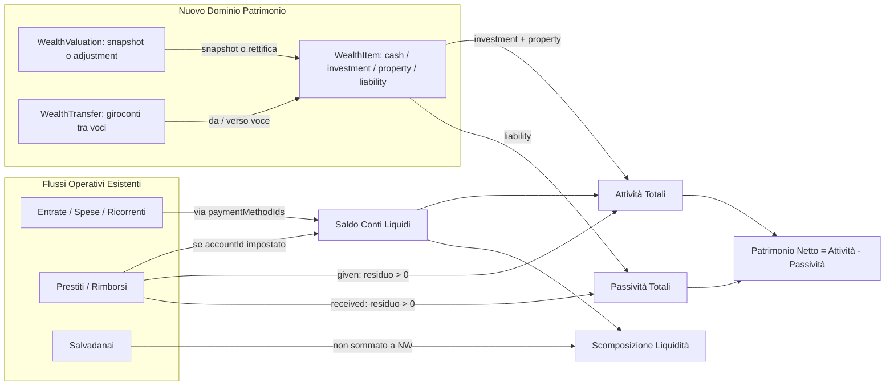

---
source-files:
  - src/types/models.ts
  - src/domain/defaults.ts
  - src/domain/calculations.ts
  - src/domain/recurrence.ts
  - src/domain/savings.ts
  - src/domain/merge.ts
  - src/domain/search.ts
  - src/domain/backupReminder.ts
  - src/services/migration.ts
  - src/services/exportData.ts
  - src/stores/finance.ts
  - src/router/index.ts
  - src/components/BottomNav.vue
  - src/components/BalancePanel.vue
  - src/components/SearchModal.vue
  - src/components/LoanForm.vue
  - src/components/RepaymentForm.vue
  - src/views/DashboardView.vue
  - src/views/LoansView.vue
  - src/views/SettingsView.vue
verified: 2026-11-19
---

# Progetto e Piano Implementativo: Sezione Patrimonio (PKT-21)

Questo documento definisce l'architettura dati, la logica contabile pura, le regole di sincronizzazione e il piano operativo per introdurre la sezione **Patrimonio** (`/patrimonio`) in **Pocketly**, tracciata in [Backlog di Pocketly](../backlog.md) sotto **PKT-21** (assorbendo ed estendendo l'idea **PKT-07**).

---

## 1. Obiettivo e Scelte Progettuali

Pocketly oggi gestisce essenzialmente **flussi** operativi (entrate, spese una tantum, spese ricorrenti): come documentato in [`DashboardView.vue`](../../src/views/DashboardView.vue), l'app mostra il *Risultato* del periodo perché non conosce i saldi reali di partenza dei conti né gli asset e le passività fuori dai movimenti quotidiani.

La sezione **Patrimonio** introduce la dimensione **stock / stato patrimoniale** (`Attività − Passività = Patrimonio Netto`) rispettando tutti gli invarianti dell'app (`Cents` interi, `IsoDate` `YYYY-MM-DD`, zero dipendenze esterne per i grafici, privacy-first, offline-first, merge 3-way senza tombstone e 6 combinazioni piattaforma × tema):

| Asse | Decisione architetturale adottata |
|---|---|
| **Perimetro patrimoniale** | Completo a macro-classi: **Liquidità/Conti** (`cash`), **Investimenti e Risparmio** (`investment`), **Beni e Immobili** (`property`), **Passività e Debiti** (`liability`), integrati con **Prestiti** (`Loan`) e **Salvadanai** (`SavingsGoal`). |
| **Aggiornamento saldi (Modello ibrido)** | I **conti liquidi** collegati a metodi di pagamento si aggiornano automaticamente da saldo iniziale + entrate − uscite − ricorrenze + giroconti + eventuali prestiti associati, con azione rapida **«Allinea saldo»** (`adjustment`). **Investimenti, beni, passività** (e conti non collegati) usano **valutazioni periodiche** (`snapshot` data + valore) e **giroconti**. |
| **Zero doppi conteggi** | I **Prestiti** aperti entrano automaticamente come Crediti (`given`) o Debiti (`received`); per i nuovi prestiti/rimborsi è opzionale associare il conto liquido coinvolto. I **Salvadanai** restano una ripartizione logica della liquidità totale (*Accantonata* vs *Libera*), senza sommarsi una seconda volta al Patrimonio Netto. |
| **Analisi e storico** | Ripartizione percentuale per macro-classe, confronto con il mese precedente, serie storica mensile con grafico SVG leggero senza librerie esterne e tabella mensile accessibile. |
| **Integrazione nell'app** | Card sintetica in **Dashboard** (quando esistono voci patrimoniali), indicizzazione in **Omnisearch**, esportazione tabellare in **XLSX/CSV**, incremento `CURRENT_SCHEMA_VERSION` da `3` a `4`. |

---

## 2. Architettura dei Flussi e Modello Matematico



### 2.1 Regola puntuale alla data `d` (`itemValueAt`)

Questa regola garantisce assenza di buchi temporali (es. un giroconto PAC da Conto Corrente a ETF prima della nuova valutazione mensile) e continuità nella giornata corrente:

1. **Periodo attivo:** se `d < item.initialDate` (e non esistono valutazioni `snapshot` anteriori), la voce non è ancora attiva in quella data (restituisce `null` e non altera i totali storici dei mesi precedenti).
2. **Base di partenza alla data `d`:**
   - Cerca l'ultima `WealthValuation` della voce con `mode === 'snapshot'` e `date <= d` (a parità di data prevale l'ultima in ordine di inserimento).
   - Se esiste uno `snapshot` `S`: `base = S.amount`; concorrono tutti i flussi con `mov.date > S.date && mov.date <= d` (per eventuali `adjustment` nello stesso giorno di `S`, contano solo quelli successivi a `S` nell'array `wealthValuations`).
   - Altrimenti: `base = item.initialAmount`; concorrono tutti i flussi con `mov.date >= item.initialDate && mov.date <= d`.
3. **Flussi inclusi nell'intervallo:**
   - Solo per `item.kind === 'cash'` con `item.paymentMethodIds?.length`:
     - `+ incomes` e `− oneTimeExpenses` aventi `paymentMethodId ∈ item.paymentMethodIds`;
     - `− chargesBetween(r, rangeStart, d)` per ogni `RecurringExpense` con `paymentMethodId ∈ item.paymentMethodIds` (rispettando `exceptions` e `splitRecurring` tramite [`recurrence.ts`](../../src/domain/recurrence.ts));
     - `+ / − Loan` e `Repayment` con `accountId === item.id` (`given` scala al prestito e rientra al rimborso; `received` entra al prestito e scala al rimborso).
   - Per **tutte** le voci (`cash`, `investment`, `property`, `liability`):
     - **Giroconti (`WealthTransfer`):**
       - Su `fromItemId`: `−amount` per attività (`cash`, `investment`, `property`), `+amount` per `liability` (es. erogazione);
       - Su `toItemId`: `+amount` per attività, `−amount` per `liability` (es. rimborso quota capitale).
     - **Rettifiche (`WealthValuation` con `mode === 'adjustment'`):** `+amount` (delta positivo o negativo).
4. **Riconciliazione conti collegati (`Allinea saldo`):**
   - Su un conto `cash` collegato a metodi di pagamento, «Allinea saldo» registra un `adjustment` pari a `targetBalance - currentCalculatedBalance` alla data `today`: il saldo immediato coincide con quello della banca, lo storico dei mesi passati resta inalterato e le spese registrate più tardi nello stesso giorno continuano a scalare normalmente.
   - In fase di creazione di un nuovo conto `cash` con `initialDate = today` e metodi di pagamento che hanno già movimenti in data odierna, il modulo mostra in anteprima lo scostamento permettendo di inserire direttamente il saldo bancario attuale (calcolando `initialAmount` al netto dei movimenti già registrati oggi).

### 2.2 Integrazione con Prestiti e Salvadanai

- **Prestiti ([`Loan`](../../src/types/models.ts)):**
  - Alla data `d`, ogni prestito con `loan.date <= d` contribuisce per `remainingAt(d) = Math.max(0, loan.amount - sum(repayments con date <= d))`:
    - `type === 'given'` → **Crediti** (Attività);
    - `type === 'received'` → **Debiti da prestiti** (Passività).
  - Un nuovo prestito o rimborso può opzionalmente indicare `accountId` (un conto `cash`), così l'uscita/entrata di cassa bilancia automaticamente il credito/debito senza variare artificialmente il Patrimonio Netto. I prestiti pregressi con `accountId === undefined` non toccano i conti liquidi.
- **Salvadanai ([`SavingsGoal`](../../src/types/models.ts)):**
  - `Liquidità totale` = somma dei conti `cash`.
  - `Accantonata nei salvadanai` = `savingsSummary(withSavedAmounts(...)).totalCurrent` (da [`savings.ts`](../../src/domain/savings.ts)).
  - `Liquidità libera` = `Liquidità totale − Accantonata nei salvadanai` (con segnalazione `overAllocatedSavings` se negativa).
  - Il **Patrimonio Netto** utilizza `Liquidità totale` e non somma i salvadanai una seconda volta.

---

## 3. Specifiche Tecniche per l'Implementazione

### 3.1 Modello Dati, Default e Migrazione (`src/types/models.ts`, `src/domain/defaults.ts`, `src/services/migration.ts`)

1. **[`src/types/models.ts`](../../src/types/models.ts):**
   - Definire:
     - `export type WealthKind = 'cash' | 'investment' | 'property' | 'liability'`
     - `export type WealthValuationMode = 'snapshot' | 'adjustment'`
     - `WealthItem`: `{ id: Id; name: string; kind: WealthKind; initialAmount: Cents; initialDate: IsoDate; paymentMethodIds?: Id[]; color?: string; notes?: string; archived?: boolean }` (`initialAmount >= 0` per `investment`, `property`, `liability`; qualsiasi `Cents` intero per `cash` per coprire eventuali scoperti).
     - `WealthValuation`: `{ id: Id; itemId: Id; date: IsoDate; amount: Cents; mode: WealthValuationMode; notes?: string }`
     - `WealthTransfer`: `{ id: Id; date: IsoDate; amount: Cents; fromItemId?: Id; toItemId?: Id; notes?: string }`
   - Aggiungere `accountId?: Id` opzionale su `Loan` e `Repayment`.
   - Aggiungere `wealthItems: WealthItem[]`, `wealthValuations: WealthValuation[]`, `wealthTransfers: WealthTransfer[]` a `FinanceData`.
   - Alzare `CURRENT_SCHEMA_VERSION` da `3` a `4`.
2. **[`src/domain/defaults.ts`](../../src/domain/defaults.ts):**
   - Inizializzare `wealthItems: []`, `wealthValuations: []`, `wealthTransfers: []` in `createEmptyData()` (ereditato da `createDefaultData()`).
3. **[`src/services/migration.ts`](../../src/services/migration.ts) & [`src/services/migration.test.ts`](../../src/services/migration.test.ts):**
   - `migrateV1`: inizializzare i tre array patrimoniali vuoti.
   - `parseBackup`: accettare `schemaVersion` `2`, `3` e `4`, portando tutto al formato `4` e sollevando `NewerFormatError` per versioni `> 4`.
   - `normalizeV2`:
     - Validare `wealthItems` (`kind` valido, `initialAmount` intero con vincolo non-negativo fuori da `cash`, `initialDate` valida, `paymentMethodIds` filtrati sui metodi esistenti e resi univoci tra tutti i conti `cash` per impedire doppi addebiti).
     - Validare `wealthValuations` (solo per `itemId` esistenti, `mode` `'snapshot' | 'adjustment'`, escludendo `adjustment` con `amount === 0` e `snapshot` negativi su voci non-`cash`).
     - Validare `wealthTransfers` (`amount > 0`, `date` valida, almeno uno tra `fromItemId` e `toItemId` valido in `wealthItems`, e `fromItemId !== toItemId`).
     - Normalizzare `accountId` opzionale su `Loan` e `Repayment` scartando riferimenti che non puntano a un `WealthItem` di tipo `'cash'`.
   - Aggiornare `migration.test.ts` (compreso il test esistente su `CURRENT_SCHEMA_VERSION`) con casi dedicati al formato `4`.

### 3.2 Dominio Puro, Merge 3-Vie, Promemoria Backup e Ricerca (`src/domain/`)

1. **Nuovo modulo `src/domain/wealth.ts` + test `src/domain/wealth.test.ts`:**
   - Esportare i tipi: `EvaluatedWealthItem`, `WealthAllocation`, `WealthLiquidityBreakdown`, `WealthSummary`, `WealthHistoryPoint`, `WealthPeriodRange` (`'6m' | '12m' | 'ytd' | 'all'`).
   - Esportare funzioni pure:
     - `usedPaymentMethodIds(items, exceptItemId?)`: mappa `Map<Id, Id>` metodo → conto proprietario.
     - `itemValueAt(data, item, date)`: calcolo puntuale al giorno `date`.
     - `reconciliationDelta(data, item, targetAmount, date)`: delta necessario per allineare il conto a `targetAmount`.
     - `wealthSummary(data, today)`: voci valutate con variazione rispetto a fine mese precedente, totali per macro-classe, `assetsTotal`, `liabilitiesTotal`, `netWorth`, `allocation`, `liquidityBreakdown` (con salvadanai) e confronto sul mese precedente.
     - `wealthHistory(data, today)`: serie mensile pre-indicizzata (evitando scansioni ripetute su grandi archivi) dalla prima data patrimoniale significativa fino a `today`.
     - `filterHistoryRange(points, range, today)`: filtro per orizzonte `6m`, `12m`, `ytd`, `all`.
2. **[`src/domain/merge.ts`](../../src/domain/merge.ts) & [`src/domain/merge.test.ts`](../../src/domain/merge.test.ts):**
   - `mergeIdList` gestisce nativamente `wealthItems`, `wealthValuations` e `wealthTransfers`.
   - Estendere `repairReferences`:
     - Ripristinare da `sources` eventuali `paymentMethods` cancellati altrove ma ancora referenziati in `wealthItems[].paymentMethodIds`;
     - Garantire l'unicità di `paymentMethodId` tra più `WealthItem` anche dopo modifiche concorrenti su due dispositivi;
     - Ripristinare `WealthItem` cancellati su un dispositivo se sull'altro sono arrivati `wealthValuations`, `wealthTransfers` o `loans`/`repayments` con `accountId` che vi puntano (come già avviene per `savingsGoals`); ripulire eventuali riferimenti orfani assenti in tutte le sorgenti.
3. **[`src/domain/backupReminder.ts`](../../src/domain/backupReminder.ts):**
   - Includere `wealthItems`, `wealthValuations`, `wealthTransfers` in `hasUserData(data)`.
4. **[`src/domain/search.ts`](../../src/domain/search.ts) & [`src/domain/search.test.ts`](../../src/domain/search.test.ts):**
   - Aggiungere `'wealth'` a `SearchResultKind` (con `wealthKind?: WealthKind`) e indicizzare `wealthItems` per nome, macro-classe (IT/EN), note, importo attuale e metodi collegati.

### 3.3 Store Pinia ed Esportazione (`src/stores/finance.ts`, `src/services/exportData.ts`)

1. **[`src/stores/finance.ts`](../../src/stores/finance.ts) & [`src/stores/finance.test.ts`](../../src/stores/finance.test.ts):**
   - Computed: `wealthSummaryData`, `wealthHistoryData`, `cashAccounts` (conti `cash` non archiviati), `wealthTransfersSorted`.
   - Azioni:
     - `saveWealthItem(item)`: upsert con assegnazione colore `pickUniqueColor` se assente e rimozione automatica dei `paymentMethodIds` eventualmente già assegnati ad altri conti;
     - `deleteWealthItem(id)`: rimozione voce, relative `wealthValuations`, pulizia/rimozione `wealthTransfers` associati e rimozione `accountId` su `loans`/`repayments`;
     - `addWealthValuation(v)` / `deleteWealthValuation(id)`;
     - `reconcileCashAccount(itemId, targetAmount, date, notes?)`: crea `'adjustment'` sui conti collegati a metodi (se `delta !== 0`) o `'snapshot'` sui conti manuali;
     - `saveWealthTransfer(transfer)` / `deleteWealthTransfer(id)`;
     - Aggiornare `saveLoan` / `addRepayment` per supportare `accountId` opzionale;
     - Aggiornare `deleteTag('paymentMethods', id, reassignTo)` per aggiornare o rimuovere `id` in `wealthItems[].paymentMethodIds`.
2. **[`src/services/exportData.ts`](../../src/services/exportData.ts) & [`src/services/exportData.test.ts`](../../src/services/exportData.test.ts):**
   - Aggiungere `'wealth'` a `ExportFormat` e la tabella `Patrimonio` (`patrimonio.csv` / `wealth.csv`) in `extractSectionTables` (classe, valore attuale, valore iniziale, data iniziale, metodi collegati, ultimo aggiornamento, note), più `Movimenti patrimonio` (`wealth-movements`) in `xlsx`/`zip` quando esistono valutazioni o giroconti.

### 3.4 Routing, Viste, Componenti UI, Stile e i18n

1. **[`src/router/index.ts`](../../src/router/index.ts):**
   - Aggiungere `{ name: 'patrimony', path: '/patrimonio', icon: 'fa-landmark' }` in `TABS` (subito dopo `budget`, prima di `loans`) e la rotta lazy-loaded `/patrimonio` con `meta: { periodInPage: true }`.
2. **Nuova vista `src/views/PatrimonyView.vue`:**
   - `PageHeader` + `usePageAction` per «Nuova voce» (con pulsante anche per «Nuovo giroconto»).
   - Stato vuoto guidato se `wealthItems.length === 0` (mostrando comunque eventuali totali da Prestiti e Salvadanai esistenti).
   - **Hero Patrimonio Netto:** valore netto (`text-positive` se `>= 0`, `text-negative` se `< 0`), variazione rispetto al mese scorso, Attività totali vs Passività totali, barra di allocazione percentuale e sotto-riquadro **Liquidità e Salvadanai** (con link a `/budget?tab=savings`).
   - **Sezione Storico:** selettore orizzonte (`6M`, `12M`, `YTD`, `Tutto`), grafico SVG puro `WealthHistoryChart.vue` con selezione interattiva dei punti mensili e vista tabellare accessibile alternativa/espandibile.
   - **Elenco per Macro-classe** (con `useHighlight` per `?highlight=`): Liquidità/Conti (con «Allinea saldo» e «Storico»), Investimenti, Beni/Immobili, Passività (con «Aggiorna valore» e «Storico»), Crediti e Debiti da Prestiti (sola lettura con link a `/prestiti?highlight=...`), più **Giroconti recenti**.
3. **Nuovi componenti UI (usando [`BaseModal.vue`](../../src/components/BaseModal.vue), `useDirty`, `useFormErrors`, [`SubmitButton.vue`](../../src/components/SubmitButton.vue) e soli gettoni semantici di [`src/style.css`](../../src/style.css)):**
   - `src/components/WealthItemForm.vue`: creazione/modifica voce, scelta classe, `paymentMethodIds` (con indicazione se un metodo appartiene già a un altro conto), anteprima movimenti odierni per conti `cash`, colore/note/archiviazione.
   - `src/components/WealthValuationModal.vue`: aggiornamento rapido valore (`snapshot`) o riconciliazione (`Allinea saldo` → `adjustment`) + elenco storico valutazioni/rettifiche con aggiunta retroattiva ed eliminazione.
   - `src/components/WealthTransferModal.vue`: inserimento/modifica giroconto (`fromItemId`, `toItemId`, `amount`, `date`, `notes`) con validazione `fromItemId !== toItemId`.
   - `src/components/WealthHistoryChart.vue`: grafico lineare/area SVG reattivo senza dipendenze esterne, accessibile da tastiera/screen reader e stilizzato con le variabili CSS `--pk-*`.
4. **Aggiornamento viste/componenti esistenti:**
   - [`DashboardView.vue`](../../src/views/DashboardView.vue): aggiornare `isEmpty` per includere `wealthItems` / `wealthTransfers`; quando esistono voci patrimoniali, mostrare una card compatta **«Patrimonio e liquidità»** sotto [`BalancePanel.vue`](../../src/components/BalancePanel.vue) con liquidità reale (e quota accantonata nei salvadanai), patrimonio netto e link a `/patrimonio`, lasciando inalterato il *Risultato* operativo del periodo.
   - [`LoanForm.vue`](../../src/components/LoanForm.vue), [`RepaymentForm.vue`](../../src/components/RepaymentForm.vue), [`LoansView.vue`](../../src/views/LoansView.vue): selettore opzionale «Conto liquido coinvolto» (visibile se `finance.cashAccounts.length > 0` o se già impostato) e badge del conto collegato nella card prestito.
   - [`SearchModal.vue`](../../src/components/SearchModal.vue): supporto a `kind === 'wealth'` con navigazione verso `/patrimonio?highlight=<id>`.
   - [`SettingsView.vue`](../../src/views/SettingsView.vue): aggiunta opzione `wealth` nel menu dell'esportazione tabellare.
   - [`src/i18n/it.ts`](../../src/i18n/it.ts) & [`src/i18n/en.ts`](../../src/i18n/en.ts): traduzioni simmetriche complete (`nav.patrimony`, `patrimony.*`, `dashboard.wealth*`, `loans.account*`, `search.kinds.wealth`, `tabularExport.formatWealth`).

### 3.5 Documentazione di Progetto (nello stesso commit)

Al completamento dell'implementazione di **PKT-21**, aggiornare:
- [`docs/riferimento/mappa-codice.md`](../riferimento/mappa-codice.md) (censimento di tutti i nuovi file in `src/`).
- [`docs/riferimento/modello-dati.md`](../riferimento/modello-dati.md) (`CURRENT_SCHEMA_VERSION = 4` e nuove interfacce).
- [`docs/riferimento/domain.md`](../riferimento/domain.md), [`docs/riferimento/componenti-e-viste.md`](../riferimento/componenti-e-viste.md), [`docs/panoramica.md`](../panoramica.md), [`docs/architettura/dati-e-sincronizzazione.md`](../architettura/dati-e-sincronizzazione.md), [`docs/architettura/frontend.md`](../architettura/frontend.md).
- [`docs/backlog.md`](../backlog.md) (chiusura `PKT-21`, eventuale aggiornamento `PKT-07` e `PKT-19`).

---

## 4. Decisioni Operative da Confermare Prima di Scrivere Codice

1. **Posizione in `TABS`:** confermare l'inserimento di `patrimony` nel menu **Altro** su mobile (subito dopo *Budget*, mantenendo *Dashboard*, *Variabili*, *Ricorrenti* ed *Entrate* nella dock a 4 tab) e nella sidebar su desktop.
2. **Ramo e rollout `schemaVersion = 4`:** aprire il ramo dedicato `feature/patrimonio` da `develop` e coordinare il ricaricamento dei dispositivi connessi al server sync dopo la pubblicazione (come già fatto per `PKT-06`).

---

## 5. Piano di Verifica

### Controlli Automatici
```bash
npm run test          # Vitest: suite esistente + wealth.test.ts + migration.test.ts + merge.test.ts + search.test.ts + exportData.test.ts + finance.test.ts
npm run typecheck     # vue-tsc -b: zero errori TypeScript
npm run test:server   # unittest server Python
npm run build         # build di produzione + PWA
npm run docs:check    # link markdown, mappa codice e simmetria it.ts/en.ts
```

### Verifica Manuale (UAT)
1. **Conti liquidi e Dashboard:** collegare un conto ai metodi di pagamento, registrare spesa e entrata → verificare saldo conto e card Dashboard senza alterazioni al *Risultato* del periodo.
2. **Allinea saldo:** riconciliare un conto e registrare subito dopo una spesa nella stessa giornata → verificare che la spesa continui a scalare dal saldo allineato.
3. **Investimenti e giroconti:** creare un ETF, registrare un giroconto dal conto corrente verso ETF → verificare invarianza del Patrimonio Netto e aggiornamento della serie storica dopo nuova valutazione `snapshot`.
4. **Prestiti e Salvadanai:** verificare assenza di doppi conteggi nei Crediti/Debiti da Prestiti e nella scomposizione *Liquidità libera vs Accantonata*.
5. **Ricerca & Export:** verificare `Ctrl+K` / Cerca verso `/patrimonio?highlight=` ed export `.xlsx`/`.csv`.
6. **6 combinazioni UI:** verificare `PatrimonyView`, modali e grafico SVG su `ios` / `android` / `desktop` × `light` / `dark`.
