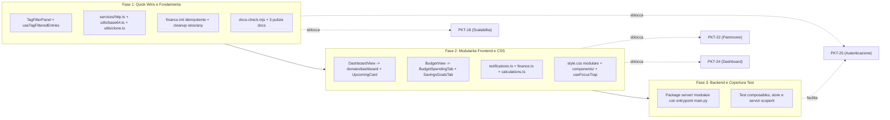

---
source-files:
  - src/views/OneTimeView.vue
  - src/views/IncomeView.vue
  - src/views/DashboardView.vue
  - src/views/BudgetView.vue
  - src/components/BottomNav.vue
  - src/components/BaseModal.vue
  - src/components/TagManager.vue
  - src/components/RecurringForm.vue
  - src/components/settings/SettingsDataSection.vue
  - src/stores/finance.ts
  - src/stores/notifications.ts
  - src/stores/sync.ts
  - src/stores/backup.ts
  - src/stores/appearance.ts
  - src/domain/calculations.ts
  - src/domain/recurrence.ts
  - src/domain/tags.ts
  - src/services/storage.ts
  - src/services/sync/api.ts
  - src/services/sync/engine.ts
  - src/services/notifications/api.ts
  - src/services/backupCrypto.ts
  - src/services/notifications/webpushCrypto.ts
  - src/services/excelImport.ts
  - src/utils/platform.ts
  - src/utils/dates.ts
  - src/style.css
  - server/main.py
  - server/webpush.py
  - scripts/docs-check.mjs
verified: 2026-11-24
---

# Analisi e Piano di Miglioramento Strutturale (PKT-15)

Questo documento raccoglie l'analisi architetturale, organizzativa e di manutenibilità della struttura attuale di **Pocketly** (tracciata in [Backlog di Pocketly](../backlog.md) sotto **PKT-15**) e definisce la strategia implementativa incrementale da eseguire in **PKT-27**.

---

## 1. Sintesi del Verdetto e Metriche Baseline (2026-11-24)

L'architettura a strati di Pocketly (descritta in [frontend.md](./frontend.md) e [backend.md](./backend.md)) è complessivamente pulita e coerente con i principi **privacy-first**, **offline-first** e **Zero-Knowledge**. La crescita rapida delle funzionalità recenti (`PKT-04`, `PKT-05`, `PKT-16`, `PKT-19`, `PKT-20`, `PKT-21`, `PKT-26`) ha però concentrato molte responsabilità in pochi file di grandi dimensioni e lasciato alcune duplicazioni mirate che conviene riordinare prima dell'arrivo di `PKT-22` (Patrimonio) e `PKT-25` (Autenticazione).

### Baseline Empirica Verificata
- **Perimetro codice:** 141 file censiti in `mappa-codice.md`, **21.602 righe** di codice sorgente (`src/`, `server/`, `scripts/`) + **5.748 righe** di test.
- **Suite automatiche:** `npm run test` verde (25 suite, 341 test), `npm run test:server` verde (31 test), `npm run docs:check` verde (703 chiavi i18n allineate su `it.ts`/`en.ts`, 574 link interni validi), **0 colori Tailwind hardcoded** nei sorgenti Vue/TS.
- **File più estesi:** [`calculations.ts`](../../src/domain/calculations.ts), [`server/main.py`](../../server/main.py), [`notifications.ts`](../../src/stores/notifications.ts), [`DashboardView.vue`](../../src/views/DashboardView.vue), [`BudgetView.vue`](../../src/views/BudgetView.vue), [`style.css`](../../src/style.css), [`finance.ts`](../../src/stores/finance.ts).

| Strato | Valutazione attuale | Motivo principale |
|---|---|---|
| **Dominio (`src/domain/`)** | **Buona** | Moduli puri e ben testati, ma `calculations.ts` accorpa 7 sottodomini e alcune mutazioni pure vivono ancora nello store `finance.ts`. |
| **Store Pinia (`src/stores/`)** | **Da riordinare** | `notifications.ts` e `finance.ts` concentrano troppe responsabilità; `finance.init()` manca di guardia di idempotenza e cleanup; `as any` in `notifications.ts`. |
| **Viste (`src/views/`)** | **Da riordinare** | Duplicazione quasi speculare tra `OneTimeView.vue` e `IncomeView.vue`; `DashboardView.vue` e `BudgetView.vue` troppo dense e non scomponibili. |
| **Componenti UI (`src/components/`)** | **Discreta** | 39 componenti quasi tutti piatti nella root (solo `settings/` è raggruppata); `BottomNav.vue` re-implementa focus-trap/`Escape` di `BaseModal.vue`. |
| **Servizi e Utility (`src/services/`, `src/utils/`)** | **Migliorabile** | Trasporto HTTP `call()` duplicato tra `sync/api.ts` e `notifications/api.ts`; codec Base64 duplicato tra moduli crypto; `JSON.parse(JSON.stringify(...))` ripetuto in 7 punti; helper date duplicati in `excelImport.ts`. |
| **Stile (`src/style.css`)** | **Buona ma densa** | Gettoni semantici rispettati al 100% nei componenti, ma 4 aree CSS in un unico file, 2 blocchi adiacenti duplicati per `.sheet .field` e `:focus-visible` su `--color-emerald-600`. |
| **Backend (`server/`)** | **Funzionale ma monolitico** | `server/main.py` concentra storage atomico, push store, rate limiting, validatori, handler HTTP e CLI in un unico file. |
| **Quality Gates & Test** | **Parziale fuori da `domain/`** | `docs-check.mjs` non valida ancora `source-files` né l'Invariante #8; mancano test unitari dedicati su molti composables, store (`sync`, `backup`, `appearance`) e servizi (`storage`, API HTTP). |

### Punti di Forza e Invarianti da Preservare
Ogni intervento proposto in questo documento **deve preservare senza deroghe** gli invarianti di [AGENTS.md](../../AGENTS.md):
1. Importi monetari memorizzati esclusivamente in centesimi interi (`Cents`).
2. Date di calendario nel formato locale `YYYY-MM-DD` (`IsoDate`).
3. Entità referenziate sempre tramite `Id` (categorie, metodi di pagamento, tag).
4. Logica di business e formule matematiche confinate e testate in `src/domain/`.
5. Persistenza `FinanceData` isolata dietro `DataStore` (`src/services/storage.ts`).
6. Sync Zero-Knowledge con merge a 3 vie senza tombstone (`src/domain/merge.ts`).
7. Simmetria i18n `it.ts` / `en.ts` verificata da `npm run docs:check`.
8. Solo gettoni semantici in `src/style.css` con verifica visiva sulle 6 combinazioni `data-platform` × `data-theme`.

---

## 2. Diagnosi Strutturale Verificata sul Codice

### 2.1 Viste e Componenti UI (`src/views/`, `src/components/`)

1. **Duplicazione quasi speculare tra [`OneTimeView.vue`](../../src/views/OneTimeView.vue) e [`IncomeView.vue`](../../src/views/IncomeView.vue):**
   - Entrambe le viste ripetono circa l'85% di logica e markup: barra orizzontale dei filtri per tag (`activeYearTags`), pannello collassabile con barre percentuali (`showBreakdown` + `tagBreakdown`), banner informativo del tag attivo con totale annuo e pulsante «Vedi tutto l'anno», logica di reset del filtro in `useHighlight`, `emptyText`, `totalLabel`, `duplicate` e `remove`.
   - È un debito già annotato in `PKT-06` («filtri dei tag copiati tra Entrate e Spese, da riordinare con `PKT-15`»).
   - Inoltre `OneTimeView.vue` importa ancora l'alias di retrocompatibilità `oneTimeTagBreakdown` da `calculations.ts`, ed entrambe le viste ricalcolano il conteggio nel mese in `O(T × N)` invocando `displayedExpensesCountForTag` / `displayedIncomesCountForTag` dentro `activeYearTags.map(...)` anziché costruire una `Map` in un singolo passaggio.

2. **Concentrazione di responsabilità in [`DashboardView.vue`](../../src/views/DashboardView.vue):**
   - La vista unisce quattro compiti distinti:
     1. Costruzione completa del view-model per `BalancePanel` (`mainFigure`, `explain`, `expensesSplit`, `savingsLine`, `incomeAhead`, `estimateDecisive`, `withoutEstimate`) — ~260 righe di logica non testate unitariamente;
     2. La funzione matematica pura `paceSoFar` definita direttamente dentro lo `<script setup>` della vista invece che in `src/domain/`, in tensione con l'Invariante #4 di `AGENTS.md`;
     3. Rendering e interazione della card inline «Prossimi addebiti» (raggruppamento `upcomingGroups` che rifiltra `upcoming` dentro il ciclo `for`, espansione `UPCOMING_FIRST`, apertura di `TransactionForm`/`RecurringForm` e ripristino del focus tramite `data-charge-key`);
     4. Gestione touch swipe (`onTouchStart`/`onTouchEnd`) e ripristino del focus di ritorno da `/dettaglio/*`.
   - Questa struttura rende fragile l'aggiunta di interruttori per nascondere/mostrare singoli blocchi della Dashboard (`PKT-24`) o la nuova card sintetica del Patrimonio (`PKT-22`).

3. **Accorpamento di due viste e ricalcoli nel template in [`BudgetView.vue`](../../src/views/BudgetView.vue):**
   - `BudgetView.vue` unisce due domini UI quasi indipendenti: pianificazione mensile dei limiti (`panel-budget`) e gestione Salvadanai/obiettivi di risparmio (`panel-savings`).
   - Nel ciclo `v-for="goal in finance.savingsGoals"`, il template invoca direttamente `goalStatus(goal, finance.today)` 4 volte per card, `calculateGoalProgress(goal)` 3 volte e `calculateMonthsRemaining(finance.today, goal.targetDate)` 2 volte anziché pre-calcolare un view-model per riga/card.
   - `switchTab` usa un cast `Record<string, any>` per `nextQuery`.

4. **Organizzazione piatta di `src/components/` e duplicazione modale/focus-trap:**
   - Su 39 componenti in `src/components/`, 35 si trovano direttamente nella root (solo `src/components/settings/` è raggruppata), includendo file corposi come [`TagManager.vue`](../../src/components/TagManager.vue), [`RecurringForm.vue`](../../src/components/RecurringForm.vue), [`BaseModal.vue`](../../src/components/BaseModal.vue), [`SettingsDataSection.vue`](../../src/components/settings/SettingsDataSection.vue) e [`BottomNav.vue`](../../src/components/BottomNav.vue).
   - [`BottomNav.vue`](../../src/components/BottomNav.vue) re-implementa manualmente la logica di focus trap (`FOCUSABLE`, `Tab`/`Shift+Tab`), chiusura su `Escape` e ripristino del focus precedente per il foglio «Altro», duplicando la meccanica già gestita da [`BaseModal.vue`](../../src/components/BaseModal.vue).

### 2.2 Store Pinia e Strato di Dominio (`src/stores/`, `src/domain/`)

1. **[`src/stores/notifications.ts`](../../src/stores/notifications.ts) — file applicativo più grande del frontend con 5 responsabilità diverse:**
   - **Rilevamento piattaforma/PWA duplicato:** definisce `isIos` e `isStandalone` localmente. Rispetto a `detectPlatform` in [`src/utils/platform.ts`](../../src/utils/platform.ts), `isIos` usa solo `/iPad|iPhone|iPod/.test(navigator.userAgent)` senza controllare `navigator.maxTouchPoints > 1` (iPadOS si presenta come Mac) e contiene gli **unici due `(window as any)` / `(navigator as any)` con `// eslint-disable-next-line`** del repository (peraltro senza ESLint configurato).
   - **Adattatore browser Notifications/Service Worker:** `getServiceWorkerRegistration`, `showNotificationSafely` con triplo fallback.
   - **Lifecycle Web Push:** `subscribePush`, `leaveServer`, `onSubscriptionChanged`.
   - **Orchestrazione schedule cifrato:** `runSyncPushSchedule` con mutex manuale (`syncScheduleRunning`, `syncScheduleAgain`, `syncScheduleAgainForce`).
   - **Polling locale:** `document.addEventListener('visibilitychange', ...)` e `setInterval(..., 60_000)` senza handle di cleanup o guardia contro chiamate ripetute.

2. **[`src/stores/finance.ts`](../../src/stores/finance.ts) — store centrale prossimo al sovraccarico:**
   - Espone oltre 70 proprietà tra stato, `computed` e azioni; l'aggiunta di `wealthItems`, `wealthValuations` e `wealthTransfers` prevista da `PKT-22` porterebbe il file oltre le 800–900 righe.
   - **`init()` priva di guardia di idempotenza e di cleanup:** ogni chiamata registra un nuovo `watch(data, scheduleSave, { deep: true })` e un nuovo `document.addEventListener('visibilitychange', ...)`. In vista di `PKT-25` (blocco/sblocco locale con reset dello store via `lock()`/`unlock()`), chiamare `init()` più volte nella stessa sessione genererebbe listener e watcher duplicati.
   - **Logica di dominio pura residente nello store:** `endRecurringSeriesFrom` (manipolazione di parti ed eccezioni ricorrenti) e `deleteTag` (riassegnazione referenziale su tutte le liste di `FinanceData`) implementano regole pure su `FinanceData` direttamente nello store invece che in [`src/domain/recurrence.ts`](../../src/domain/recurrence.ts) e [`src/domain/tags.ts`](../../src/domain/tags.ts), rendendone più difficile il test isolato.

3. **[`src/domain/calculations.ts`](../../src/domain/calculations.ts) — aggregatore di 7 sottodomini:**
   - Raccoglie in un solo modulo: riepiloghi annuali/mensili (`yearSummary`, `monthSummary`, `monthBreakdown`), stime e proiezioni (`estimateCategoryIds`, `estimateMonthlyIncome`, `forecast`), confronti e verdetti (`variableSpending`, `compareToAverage`, `balanceVsAverage`, `tagTrends`), dettaglio ripartizioni (`breakdownItems`), scadenze future (`upcomingCharges`), prestiti (`loanStatus`), ripartizione tag (`tagBreakdown` + alias `oneTimeTagBreakdown`) e suggerimenti frequenti (`frequentTemplates`).
   - Separarlo in moduli coesi mantenendo `calculations.ts` come *barrel* di riesportazione azzera i rischi di rottura degli import esistenti e prepara la base per le ottimizzazioni single-pass di `PKT-18`.

### 2.3 Servizi I/O, Utility e CSS (`src/services/`, `src/utils/`, `src/style.css`)

1. **Trasporto HTTP duplicato tra [`src/services/sync/api.ts`](../../src/services/sync/api.ts) e [`src/services/notifications/api.ts`](../../src/services/notifications/api.ts):**
   - La funzione privata `call(path, init)` (gestione `AbortController`, `TIMEOUT_MS = 15_000`, `cache: 'no-store'`, mapping `401 -> SyncAuthError`, `429 -> SyncBlockedError`, errori di rete -> `SyncUnreachableError`) è copiata identica nei due file.
   - `notifications/api.ts` importa le classi di errore da `sync/api.ts`, creando un accoppiamento trasversale tra due domini fratelli. Un modulo condiviso `src/services/http.ts` fornisce un punto unico anche per l'iniezione di `Authorization: Bearer <accessToken>` e refresh token prevista in `PKT-25`.

2. **Codec Base64/Base64URL duplicato tra [`src/services/backupCrypto.ts`](../../src/services/backupCrypto.ts) e [`src/services/notifications/webpushCrypto.ts`](../../src/services/notifications/webpushCrypto.ts):**
   - `backupCrypto.ts` implementa `toBase64`/`fromBase64` mentre `webpushCrypto.ts` implementa `bytesToBase64`, `bytesToBase64Url` e `base64UrlToBytes`. Unificarli in `src/utils/base64.ts` evita duplicazioni ulteriori con i moduli crittografici di `PKT-25` (`localVault.ts`, `authCrypto.ts`).

3. **Helper date locali duplicati in [`src/services/excelImport.ts`](../../src/services/excelImport.ts) e cloni JSON sparsi:**
   - `excelImport.ts` ridefinisce localmente `iso`, `daysInMonth` e `isValidIso` invece di riutilizzare `toIsoDate`, `lastDayOfMonth` e `isValidIsoDate` da [`src/utils/dates.ts`](../../src/utils/dates.ts).
   - `JSON.parse(JSON.stringify(...))` è ripetuto in 7 punti ([`storage.ts`](../../src/services/storage.ts), [`engine.ts`](../../src/services/sync/engine.ts), [`backup.ts`](../../src/stores/backup.ts), [`sync.ts`](../../src/stores/sync.ts), [`notifications.ts`](../../src/stores/notifications.ts) ×2, [`SettingsDataSection.vue`](../../src/components/settings/SettingsDataSection.vue)). Centralizzare in `src/utils/clone.ts` (o coordinare con `structuredClone(toRaw(...))` in `PKT-18`) evita divergenze future.

4. **Struttura di [`src/style.css`](../../src/style.css):**
   - Un unico file contiene `@theme inline`, i 6 blocchi di variabili `--pk-*` (default, `dark`, `ios`, `ios+dark`, `android`, `android+dark`), `@layer base` + `@media`, `@utility` e gli override per piattaforma fuori layer.
   - Contiene due blocchi adiacenti ridondanti per `.sheet .field` (uno per `:root[data-platform='ios']` e uno per `:root[data-platform='android']`) accorpabili senza cambiare specificità né ordine di cascata.
   - La regola `:focus-visible` in `@layer base` usa direttamente `var(--color-emerald-600)` anziché il gettone semantico `--pk-accent-icon` (`var(--color-accent-icon)`).

### 2.4 Backend Python (`server/main.py`)

[`server/main.py`](../../server/main.py) concentra in un solo file:
- Persistenza JSON atomica (`write_atomic`, `Store`, `HISTORY_KEEP`);
- Storage e dispatch Web Push (`PushStore`, `PushDataError`);
- Rate limiting in memoria (`Failures`);
- Validatori di payload (`valid_payload`, `valid_device_id`, `valid_schedule_item`);
- Handler HTTP REST (`make_handler`, `push_safe`, `PocketlyHTTPServer`, `make_server`) ed entrypoint CLI `main()`.

Separare queste responsabilità in un package `server/` mantenendo `server/main.py` come entrypoint (compatibile con `deploy/proxmox/pocketly-sync.service` e `server/test_main.py`) prepara il terreno sia al backend SQLite WAL di `PKT-18` Fase 3 sia agli endpoint `/api/auth/*` e `/api/vaults/*` di `PKT-25`.

### 2.5 Quality Gates, Copertura Test e Micro-Disallineamenti Documentali

1. **Estensioni desiderabili in [`scripts/docs-check.mjs`](../../scripts/docs-check.mjs):**
   - Verificare automaticamente che tutti i file elencati nei front-matter `source-files:` dei file in `docs/` esistano davvero sul disco (prevenendo riferimenti stantii dopo futuri spostamenti).
   - Verificare automaticamente l'Invariante #8 (assenza di classi colore Tailwind fisse in `src/**/*.vue` e `src/**/*.ts`).
2. **Gap di test concentrati fuori da `src/domain/`:**
   - **Composables (8/9 senza test 1:1):** `useFormErrors`, `useDirty`, `useHighlight`, `useTrendText`, `useQuickExpenseTrigger`, `useAppUpdate`, `useConfirmDelete`, `usePageAction` (solo indirettamente testato in `ui.test.ts`).
   - **Store (3/6 senza test 1:1):** `sync.ts`, `backup.ts`, `appearance.ts`.
   - **Servizi (7/14 senza test 1:1):** in particolare `storage.ts` (incluso il percorso `loadLegacy` e il lancio di `NewerFormatError` alla base di `LoadErrorScreen`), `sync/api.ts`, `notifications/api.ts` e `backupCrypto.ts` (testato solo indirettamente via `backup.test.ts`).
3. **Tre micro-disallineamenti documentali rilevati durante l'audit:**
   - In [`docs/architettura/frontend.md`](../architettura/frontend.md) la sezione *Convenzione Cromatica Semantica (Uso del Rosso)* cita ancora vecchie classi Tailwind (`text-rose-600`, `text-slate-800`, `text-emerald-700`, `text-blue-600`, `text-slate-700`, `text-amber-700`) invece dei gettoni semantici correnti (`text-negative`, `text-ink`, `text-accent`, `text-positive`, `text-ink-2`, `text-caution`).
   - Il conteggio dei componenti UI in [`docs/README.md`](../README.md) (`27 componenti`) e [`docs/riferimento/componenti-e-viste.md`](../riferimento/componenti-e-viste.md) (`30 componenti UI`) è fermo prima dei nuovi moduli recenti (oggi sono **39** file `.vue` in `src/components/`).
   - In `docs/riferimento/componenti-e-viste.md`, nella voce `DashboardView.vue`, la frase finale *«Con l'app vuota mostra solo WelcomePanel»* è ripetuta due volte.

---

## 3. Strategia Evolutiva a 3 Fasi (Zero Breaking Changes)

L'esecuzione va divisa in **3 fasi incrementali**, ciascuna rilasciabile in PR/commit piccoli e indipendenti senza mai rompere il formato dati (`CURRENT_SCHEMA_VERSION`), le API `/api/*`, i test esistenti o l'interfaccia pubblica degli store.

- **Fase 1 — Pulizie ad alto ROI e fondamenta comuni:** elimina la duplicazione visibile (`OneTimeView`/`IncomeView`), estrae le primitive condivise (`http.ts`, `base64.ts`, `clone.ts`), riutilizza `dates.ts` in `excelImport.ts`, elimina gli `as any` in `notifications.ts`, rende idempotente `finance.init()` e rafforza `docs-check.mjs` + i 3 dettagli documentali.
- **Fase 2 — Scomposizione modulare Frontend e CSS:** spacchetta `DashboardView.vue`, `BudgetView.vue`, `notifications.ts`, `finance.ts`, `calculations.ts` e `style.css` mantenendo invariate tutte le firme pubbliche verso i consumatori; introduce `useFocusTrap` condiviso e organizza progressivamente `src/components/` per area funzionale.
- **Fase 3 — Modularizzazione Backend `server/` e Copertura Test:** scompone `server/main.py` in moduli coesi preservando CLI e import di `server/test_main.py`, e colma il gap di test unitari sui layer non di dominio.

---

## 4. Specifiche Tecniche Operative (Guida Operativa per `PKT-27`)

Questa sezione raccoglie le specifiche concrete per eseguire **PKT-27** (in una serie di PR piccole per fase o area) senza dover rianalizzare il codice da capo.

### 4.1 Deduplicazione `OneTimeView.vue` e `IncomeView.vue` (Fase 1)
- **Nuovi moduli:**
  - `src/composables/useTagFilteredEntries.ts`: incapsula `selectedTagId`, `showBreakdown`, `selectedTag`, `displayedItems`, `total`, `yearTotalForSelectedTag`, `yearCountForSelectedTag`, `breakdown` (via `tagBreakdown`), `grandTotalForBreakdown`, `activeYearTags` (calcolando `countInMonth` in un **unico passaggio** con `Map<Id, number>` invece di `O(T × N)`), `toggleTagFilter`, `highlightedId` (con reset del filtro quando la voce cercata sarebbe nascosta) e il supporto a `duplicate`/`open`.
  - `src/components/TagFilterPanel.vue`: rende la barra pillole dei tag, il toggle `tagSummary`, la card `tagBreakdown` collassabile e il banner informativo del tag attivo (parametrizzando testi i18n, classe colore importo `amountClass` e `showQuickBar` esterna).
- **Pulizia:** rimuovere l'alias legacy `oneTimeTagBreakdown` da `src/domain/calculations.ts` dopo aver migrato `OneTimeView.vue` a `tagBreakdown`.
- **Test:** aggiungere test unitari per `useTagFilteredEntries` (filtro singolo tag, toggle, conteggio `O(N)` per tag, reset filtro su highlight).

### 4.2 Servizi HTTP, Base64, Clone e Date Condivise (Fase 1)
- **`src/services/http.ts`:** estrarre `createHttpClient({ baseUrl, timeoutMs })` con gli errori condivisi `HttpAuthError` / `HttpBlockedError` / `HttpUnreachableError`, riesportando gli alias `SyncAuthError`, `SyncBlockedError`, `SyncUnreachableError` in `src/services/sync/api.ts` per non rompere i test né gli import esistenti; far usare `http.ts` anche a `src/services/notifications/api.ts` rimuovendo la dipendenza da `sync/api.ts`.
- **`src/utils/base64.ts`:** centralizzare `bytesToBase64`, `base64ToBytes`, `bytesToBase64Url`, `base64UrlToBytes` e farle riusare da `src/services/backupCrypto.ts` e `src/services/notifications/webpushCrypto.ts` (preservando le esportazioni pubbliche di quest'ultimo se usate nei test).
- **`src/utils/clone.ts`:** helper `clonePlain<T>(value: T): T` (sostituisce le 7 occorrenze di `JSON.parse(JSON.stringify(...))` nei file `storage.ts`, `engine.ts`, `backup.ts`, `sync.ts`, `notifications.ts`, `SettingsDataSection.vue`, pronto per passare a `structuredClone(toRaw(...))` in `PKT-18`).
- **`src/services/excelImport.ts`:** sostituire gli helper locali `iso`, `daysInMonth` e `isValidIso` con `toIsoDate`, `lastDayOfMonth` (o `daysInMonth` esportata da `dates.ts`) e `isValidIsoDate` di `src/utils/dates.ts`, verificando la suite `excelImport.test.ts`.

### 4.3 Guardia di Ciclo di Vita Store e Pulizia `notifications.ts` (Fase 1 & Fase 2)
- **`src/stores/finance.ts` (Fase 1):**
  - Introdurre `let initialized = false`, `stopSaveWatch: WatchStopHandle | null` e `onVisibilityChange` registrati una sola volta in `init()`, più un metodo `dispose()` (o reset in `resetForLock()` per `PKT-25`) che pulisca timer, watcher e listener in modo deterministico.
- **`src/stores/notifications.ts` (Fase 1 & Fase 2):**
  - Fase 1: sostituire `isIos` basato su regex + `(window as any).MSStream` con `detectPlatform({ userAgent: navigator.userAgent, maxTouchPoints: navigator.maxTouchPoints }) === 'ios'` da `src/utils/platform.ts`, e tipizzare `NavigatorStandalone` locale eliminando entrambi gli `as any` e i commenti `eslint-disable`. Aggiungere `cleanup()` per `setInterval` / `visibilitychange`.
  - Fase 2: estrarre in `src/services/notifications/browser.ts` le primitive browser (`getServiceWorkerRegistration`, `showNotificationSafely`, `isPushSupported`, `isStandaloneApp`) e in `src/services/notifications/scheduler.ts` la costruzione/cifratura del calendario Web Push e il rilevamento dei cambiamenti via hash, lasciando allo store pinia solo stato reattivo, azioni utente e coordinamento.

### 4.4 Scomposizione `DashboardView.vue`, `BudgetView.vue` e `src/components/` (Fase 2)
- **`DashboardView.vue`:**
  - Spostare in `src/domain/dashboard.ts` (puro e coperto da test unitari) `paceSoFar` e i builder puri del pannello saldo (`buildDashboardFigures` / `buildExplainRows`) così `DashboardView.vue` resta un coordinatore snello.
  - Estrarre la card «Prossimi addebiti» in `src/components/dashboard/DashboardUpcomingCard.vue` (precalcolando i totali mensili di `upcomingGroups` in un unico passaggio con `Map<number, number>`).
  - Estrarre la gesture di navigazione in `src/composables/useHorizontalSwipe.ts`.
- **`BudgetView.vue`:**
  - Estrarre i due pannelli in `src/components/budget/BudgetSpendingTab.vue` e `src/components/budget/SavingsGoalsTab.vue`.
  - In `SavingsGoalsTab.vue`, precalcolare in un `computed` la vista di ciascun obiettivo (`{ goal, status, progress, remaining, quota, monthsLeft }`) evitando 9 chiamate di dominio ripetute per card nel template. Sostituire `Record<string, any>` con `LocationQueryRaw`.
- **`src/components/` e `useFocusTrap.ts`:**
  - Estrarre `src/composables/useFocusTrap.ts` condiviso tra `BaseModal.vue` e il pannello «Altro» di `BottomNav.vue`.
  - Raggruppare progressivamente i componenti per area (es. `layout/`, `forms/`, `tags/`, `savings/`, `dashboard/`, `budget/`, `settings/`) quando si tocca l'area corrispondente, aggiornando contestualmente `mappa-codice.md`.

### 4.5 Modularizzazione `finance.ts`, `calculations.ts` e `style.css` (Fase 2)
- **`src/stores/finance.ts`:**
  - Spostare la logica pura di `endRecurringSeriesFrom` in `src/domain/recurrence.ts` e quella di riassegnazione `deleteTag` in `src/domain/tags.ts` con relativi test unitari.
  - Mantenere `useFinanceStore()` come facciata pubblica compatibile (stessi nomi di stato, getter e azioni), delegando i gruppi di mutazioni a helper interni per area (`transactions`, `planning`, `tags`) così da contenere la crescita prevista con `PKT-22`.
- **`src/domain/calculations.ts`:**
  - Suddividere in sottomoduli coesi sotto `src/domain/calculations/` (`summary.ts`, `forecast.ts`, `trends.ts`, `breakdown.ts`, `upcoming.ts`, `templates.ts`), mantenendo `src/domain/calculations.ts` come *barrel* che riesporta tutti i simboli pubblici senza rompere alcun import.
- **`src/style.css`:**
  - Dividere in `src/styles/tokens.css`, `src/styles/base.css`, `src/styles/utilities.css` e `src/styles/platforms.css` importati in quest'ordine da `src/style.css` (preservando la precedenza dei blocchi fuori `@layer`, incluse le regole Android dopo `:root[data-theme='dark']`).
  - Unificare i due blocchi duplicati di `.sheet .field` per iOS e Android e sostituire `var(--color-emerald-600)` in `:focus-visible` con `var(--color-accent-icon)`, verificando tutte le 6 combinazioni `data-platform` × `data-theme`.

### 4.6 Quality Gates e Copertura Test (Fase 1 & Fase 3)
- **`scripts/docs-check.mjs` (Fase 1):**
  - Aggiungere `checkFrontMatterSourceFiles()` per verificare che ogni percorso elencato in `source-files:` nei `.md` di `docs/` (escluso `archivio/`) esista realmente.
  - Aggiungere `checkSemanticColorTokens()` per far fallire `docs:check` se compaiono classi colore Tailwind fisse (`text-slate-*`, `bg-emerald-*`, ecc.) in `src/**/*.vue` o `src/**/*.ts`.
  - Aggiornare i 3 micro-disallineamenti documentali segnalati al §2.5 (`frontend.md`, `README.md`, `componenti-e-viste.md`).
- **Copertura test (Fase 3):**
  - Aggiungere test unitari per `src/services/storage.ts` (`deviceDataStore`, `loadLegacy`, `readStoredDataRaw`, `NewerFormatError`), `src/services/http.ts`, `src/stores/backup.ts`, `src/stores/sync.ts`, `src/stores/appearance.ts` e per i composables prioritari (`useFormErrors`, `useDirty`, `useHighlight`, `useQuickExpenseTrigger`, `useTagFilteredEntries`).

### 4.7 Modularizzazione Backend `server/` (Fase 3)
- Dividere `server/main.py` in:
  - `server/storage.py` (`write_atomic`, `Store`, `HISTORY_KEEP`);
  - `server/push_store.py` (`PushStore`, `PushDataError`, costanti `MAX_PUSH_*`);
  - `server/rate_limit.py` (`Failures`, `MAX_FAILURES`, `FAILURE_WINDOW_SECONDS`);
  - `server/validators.py` (`valid_payload`, `valid_device_id`, `valid_schedule_item`);
  - `server/http_handler.py` (`make_handler`, `push_safe`, `PocketlyHTTPServer`, `make_server`).
- Mantenere `server/main.py` come entrypoint CLI e modulo di riesportazione per garantire compatibilità al 100% con `deploy/proxmox/pocketly-sync.service`, `npm run test:server` (`server/test_main.py`) e zero dipendenze esterne Python 3.9+.

---

## 5. Coordinamento con il Backlog e Attività Derivate

| Task esistente | Relazione con PKT-15 / PKT-27 |
|---|---|
| **PKT-14** *(Analisi di sicurezza)* | Complementare: la centralizzazione HTTP (`http.ts`), Base64 (`base64.ts`), storage e validatori backend riduce la superficie di errore prima degli hardening. |
| **PKT-18** *(Scalabilità)* | `PKT-27` prepara la scomposizione di `calculations.ts`, `OneTimeView`/`IncomeView` e `server/main.py` senza sovrapporsi a cache, single-pass, paginazione, gzip o SQLite. |
| **PKT-22** *(Sezione Patrimonio)* | Scomporre `finance.ts`, `DashboardView.vue` e `calculations.ts` impedisce al codebase di diventare rigido all'ingresso delle nuove entità `Wealth*`. |
| **PKT-24** *(Dashboard configurabile)* | Estrarre `domain/dashboard.ts` e `DashboardUpcomingCard.vue` rende banale attivare/disattivare i singoli blocchi della Dashboard. |
| **PKT-25** *(Autenticazione)* | `finance.init()` idempotente con cleanup, `http.ts` unico e `server/` modulare sono prerequisiti diretti per lock/unlock locale, refresh token e rotte `/api/auth/*`. |

L'esecuzione operativa di questo piano è tracciata in [Backlog di Pocketly](../backlog.md) sotto l'attività:
- **PKT-27** — Implementazione piano di miglioramento strutturale e manutenibilità (da PKT-15) *(stato: `da fare`, suddivisibile per fase in PR dedicate)*.
