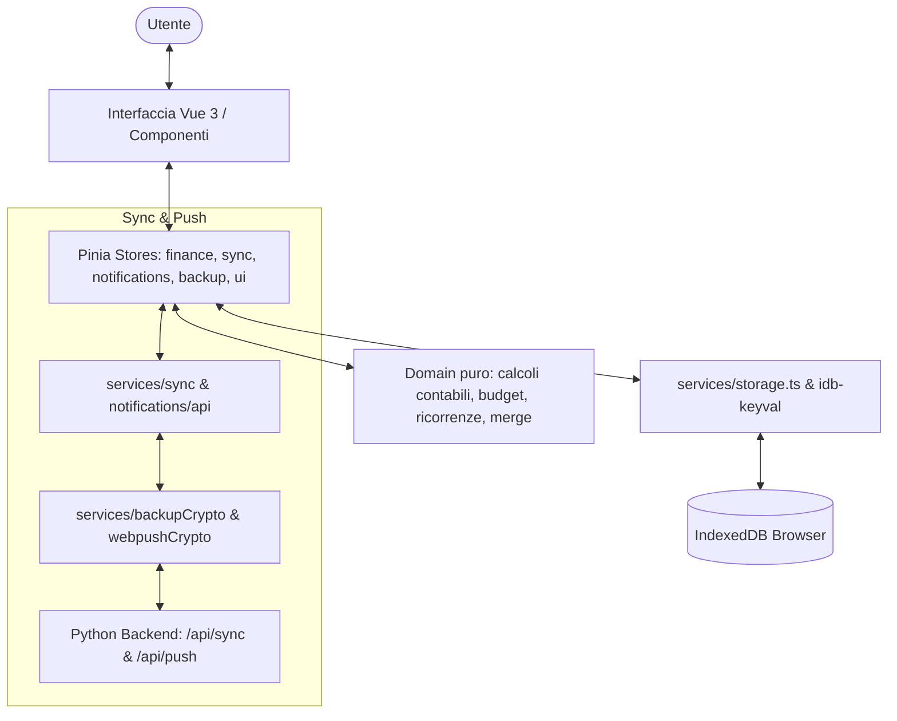

---
source-files:
  - src/App.vue
  - src/router/index.ts
  - src/types/models.ts
verified: 2026-11-10
---

# Panoramica Generale dell'Applicazione

Pocketly è una Progressive Web App (PWA) moderna, veloce e orientata alla privacy per il controllo delle finanze personali e familiari.

---

## 1. Principi Fondamentali

1. **Privacy-First & Zero-Knowledge:**
   Nessun dato finanziario viene inviato in chiaro su server cloud o esposto ad API bancarie di terzi. L'utente ha la piena proprietà dei propri dati.
2. **Offline-First:**
   L'applicazione è pienamente operativa anche in assenza totale di connettività internet. Tutte le letture e le scritture avvengono istantaneamente sul database IndexedDB locale.
3. **Sincronizzazione Opzionale Multi-Dispositivo:**
   Se l'utente desidera condividere o sincronizzare i dati tra più dispositivi (ad esempio smartphone e PC desktop), può collegare un'istanza personale del server Pocketly. Il server riceve unicamente blob cifrati via AES-GCM; la chiave di cifratura non lascia mai i dispositivi autorizzati.
4. **Precisione Contabile Assoluta:**
   Tutti gli importi memorizzati sono rappresentati come interi in centesimi di euro (`Cents = number`). Non si verificano dispersioni o errori di arrotondamento tipici del calcolo decimale floating point.

---

## 2. Le 8 Schermate Principali e la Vista di Dettaglio

La navigazione principale avviene tramite la barra di navigazione inferiore ([`BottomNav.vue`](../src/components/BottomNav.vue)), con accesso immediato a tutte le aree funzionali:

### 1. Dashboard (`/`)
La vista di riepilogo globale. Si apre sul mese corrente e permette di scorrere i mesi con i tasti freccia (← e →) o tramite swipe touch sul riquadro del saldo. Mostra il saldo complessivo, le entrate, le spese una tantum e ricorrenti del periodo. Se il saldo attuale a consuntivo è negativo ma la stima a fine periodo è positiva, una frase ponte illustra chiaramente il rientro previsto. La sezione "In arrivo" elenca tutte le uscite programmate (ricorrenti e variabili con data futura) fino a fine mese con il totale complessivo. Le righe delle ripartizioni per categoria e metodo sono interattive e conducono al rispettivo dettaglio analitico.

### 2. Spese Una Tantum (`/una-tantum`)
Permette di registrare uscite singole (data, nome, importo, categoria, metodo di pagamento, note facoltative). Offre:
- Filtro per anno e per singolo mese.
- Supporto a tag multipli colorati per ogni spesa (es. "vacanze", "regali").
- Riquadro a comparsa con spaccato di spesa dettagliato per tag sull'intero anno o sul mese corrente.

### 3. Spese Ricorrenti (`/ricorrenti`)
Dedicata a tutte le spese cicliche (bollette, mutui, canoni di abbonamento, assicurazioni).
- Frequenze disponibili: mensile, trimestrale, semestrale, annuale.
- Calcolo automatico della data del primo addebito e dell'eventuale scadenza finale.
- Calcolo del **costo equivalente mensile**, fondamentale per il budget e per capire il peso costante delle uscite periodiche.
- Sistema di promemoria avanzato stile Google Calendar: ogni spesa ricorrente può definire più regole di notifica (es. 3 giorni prima alle 09:00, 1 giorno prima alle 18:00).

### 4. Entrate (`/entrate`)
Gestione dei flussi positivi di denaro (stipendi, rimborsi, vendite, regali). Ogni entrata è associata a data, nome, importo, categoria e metodo di accredito.

### 5. Budget Mensile (`/budget`)
Permette di impostare tetti di spesa mensili per ciascuna categoria. Caratteristiche:
- Monitoraggio della spesa effettiva già registrata e di quella già programmata (spese ricorrenti o una tantum con data futura).
- Calcolo in tempo reale del "passo" di spesa (ritmo giornaliero ideale e ritmo reale).
- Evidenziazione cromatica: verde (in linea), arancione (avviso ritmo elevato), rosso (budget superato).
- Suggeritore automatico dei limiti basato sulla media storica delle spese.

### 6. Prestiti (`/prestiti`)
Tracciamento di somme di denaro prestate a terzi ("denaro dato") o ricevute in prestito ("denaro ricevuto"):
- Registrazione di pagamenti di rimborso parziali nel tempo con data e importo.
- Calcolo del saldo netto residuo (quanto ancora deve essere rimborsato o restituito).
- Stato del prestito: "Aperto" vs "Completato" al raggiungimento del saldo zero.

### 7. Previsioni & Simulazioni (`/previsioni`)
Strumento di pianificazione finanziaria per anticipare la liquidità futura:
- Tabella mese per mese da oggi fino a fine anno con entrate previste, spese programmate, saldo mensile e saldo cumulato progressivo.
- Stima intelligente delle entrate: identifica automaticamente o manualmente le entrate fisse (es. stipendio) che si ripetono e le include nei mesi futuri.
- Simulazioni di acquisto "What-If": possibilità di inserire acquisti ipotetici in un dato mese futuro per visualizzare all'istante l'impatto sul saldo di fine anno.

### 8. Impostazioni (`/impostazioni`)
Centro di controllo e configurazione dell'applicazione:
- Gestione anagrafica di categorie, metodi di pagamento e tag (creazione, modifica nome, colore, eliminazione sicura).
- Esportazione ed importazione di backup completi (in formato JSON protetto da password crittografato via AES-GCM o non cifrato).
- Collegamento e diagnostica della sincronizzazione con il server personale.
- Configurazione e test delle notifiche Web Push su dispositivi mobili e desktop.
- Selezione della lingua (Italiano / English).

### 9. Dettaglio Ripartizione Categoria / Metodo (`/dettaglio/:kind/:id`)
Vista di approfondimento accessibile direttamente dalla Dashboard toccando una categoria o un metodo di pagamento. Elenca singolarmente tutte le voci (spese variabili e addebiti ricorrenti del periodo selezionato) che concorrono alla spesa, consentendo di verificare esattamente la composizione del totale mostrato nella Dashboard.

---

## 3. Flusso Dati e Interazione

Tutti i dati risiedono primariamente in IndexedDB. Ogni volta che l'utente effettua un'operazione, la modifica viene validata, registrata nello store e salvata atomicamente in locale, notificando in background il motore di sincronizzazione se attivo.
